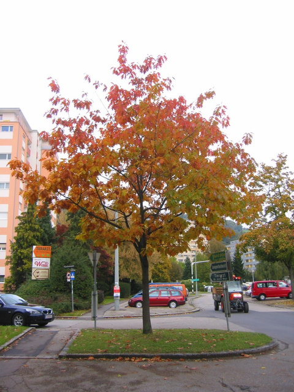

The fall/winter term already started at universty and a lot of new things are on the roadmap or have already started. Monday's dancing night now, Andrea and I started taking dancing lessons on Monday. It's interesting how well, or not so well we work as a dancing couple. But we will work on that. Taking the class with such good friends as my sister and her boyfriend (also an engineer) and another couple of friends is really fun!

Besides that, life is as always and I am currently working on some exciting new antenna ideas, but more on that later. For now I'll leave you with a photo I took of a "burning tree" that I see change color every morning when I look out of the window. It reminds me of how fast summer is turing into winter now ...

