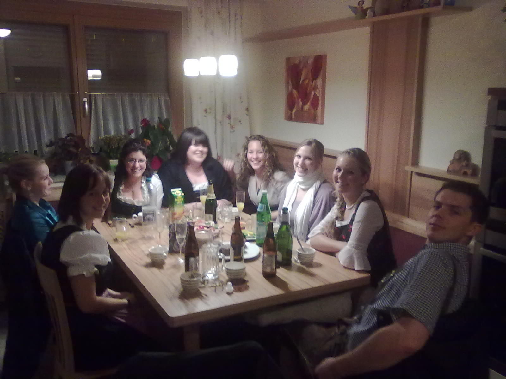
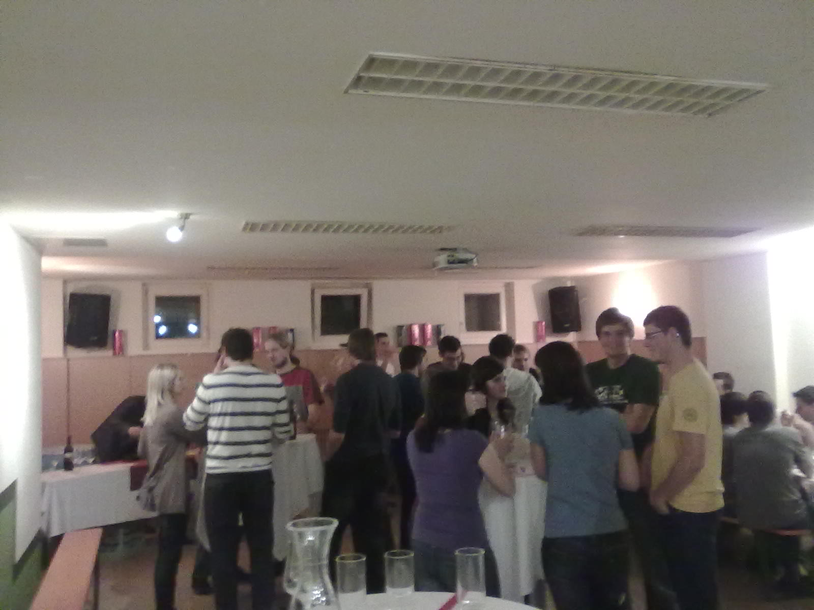
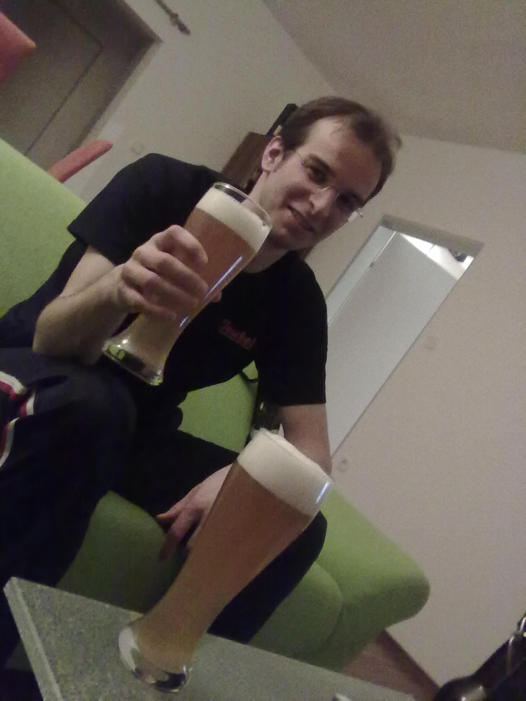

While a lot is happening at work - for those you who do care: the 77-GHz VCO and the PLL seem to lock! - spare time is fun too! Here's a photo of the party people before we went to the dace last  Saturday:

<!--more-->
Thank you Markus for not letting me alone, I enjoyed your company. On Monday I joined the people of my old dorm for the annual wine tasting. The vintner was there himself to present some of his best wines! And it was good to see all these great people, its amazing how we all evolve and still stay the same somehow. I had some great conversations with Rene, Severin, Martina, Lukas, Elisa, Richard ...

Tonight is a little bit more calm. Just a nice glass of wheat beer with my roomie Richard!

I do work a lot right now, but it is important to save these nice moments where you give yourself a break!
