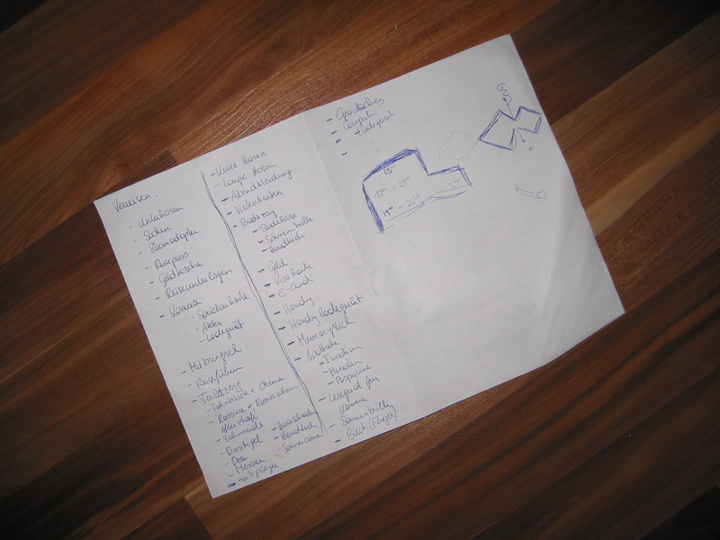

A very practical thing: A "Don't forge your ..." list before going on a journey! I prepared one for my Hawaii-LA-NYC trip. And as I did actually not miss a thing I guess it is pretty solid ;) (No legal liability here, use at your own risk!!!)

I will definitely come back here next time before any trip.  But no more waiting for now, ladies and gentlemen let me introduce to you: THE LIST:

<!--more-->
The original list was in German, so here's a translation for the English-speaking folks out there:

### Clothing:

- Undergarments
- Socks
- Shorts
- Trousers
- Evening Attire
- Swimming
- Bathing Suit
- Boggles
- Ear plugs
- Towels
- Jacket
- Lit
- Gloves

### Shoes:

- Black shoes
- Sporty shoes
- Running Shoes
- Thongs
- Flip Flops

### Wallet:

- Money
- ATM card
- Credit Card
- E-Card

### Toiletries

- Teeth brush
- Toothpaste
- Shaver
- Shaving Cream
- After Shave
- Floss
- Shower Gel
- Deo
- Swiss Army Knife
- Towels
- Sun Screen
- Electric Hair Trimmer

### Drugs:

- Imodium
- Mexalen
- Paspertine

### Electronics:

- Power Adapter
- Mobile Phone
- Charger
- Camera
- Memory Card
- Battery
- Charger
- Laptop
- Charger
- Flash Drive
- Card Reader
- GPS
- mp3 Player

### Misc:

- Passport
- Guide
- Business Card
- Maps
- Infos: Flight, Hotel, Visa
- Presents
- Sun Glasses
- Book (Flight)
- Geocaching

### Double-Check:

- Passport
- Infos: Flight, Hotel, Visa
- Wallet
- Mobile Phone
- Camera
- mp3 Player
- Sun Glasses
