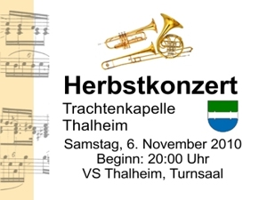

Actually only a small part of today was related to facebook. I used two facebook features I have never used before today. First I created a page for the IEEE Student Branch at the Johannes Kepler University. Check it out and "like" it if you like it :)

[Watch on Facebook](http://www.facebook.com/pages/IEEE-Student-Branch-JKU-Linz-Austria/154633711237945)

And just a few minutes ago I created an event, namely the concert of our windband in November.

It will be a great concert played by all local hobby musicians! So if you're still looking for something to happen on Saturday, November 6 check out this: [http://www.facebook.com/event.php?eid=159406067420645](http://www.facebook.com/event.php?eid=159406067420645)
