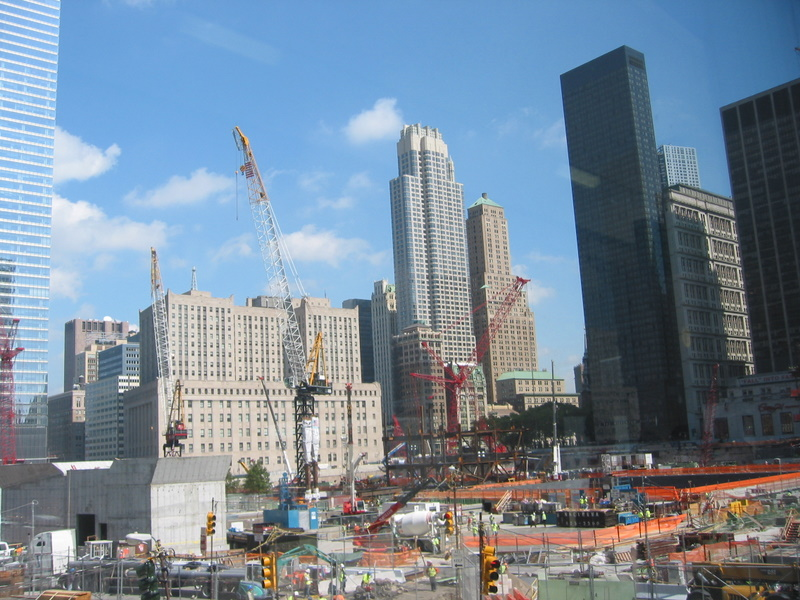

On Saturday evening I arrived in New York. The flight from LA was even an hour early, so I had plenty of time to get to the terminal where Andrea arrived. I prepared a “Andrea Leb” sign, and so she could not miss me. What a cheerful reunion! That night we just got to the hotel and got to sleep.

Sunday was different. We were going to Times Square where we happened to stumble into the “Broadway on Broadway” show which is essentially a free medley concert of all Broadway shows! For the big finale they didn’t spare the effects and so this is the wonderful first impression that Andrea and me were able to get from Time Square.

<!--more-->
Still a little bit tired of the jet lag we got to bed early, only to start exploring the city today with all our batteries fully recharged. We took the Staten Island Ferry trip for a close-up with the Statue of Liberty and wandered lower Manhatten

We also visited Ground Zero, where we were fortunate to be part of a very intimate guided tour. A married couple that has very close connections to the events of September 11th 2001 shared some historical facts as well as their personal story. Also a very emotional trip. It is amazing how they deal with it, I don’t know how I would. You can already see new buildings rise at Ground Zero!

After some late lunch / dinner we decided to visit Brooklyn Bridge, where I got this beautiful photo of Andrea, the Brooklyn Bridge and the skyline of Manhatten

Thank you New York and its people, it was a great day!
