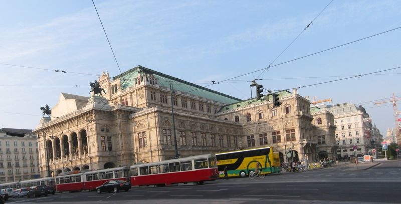
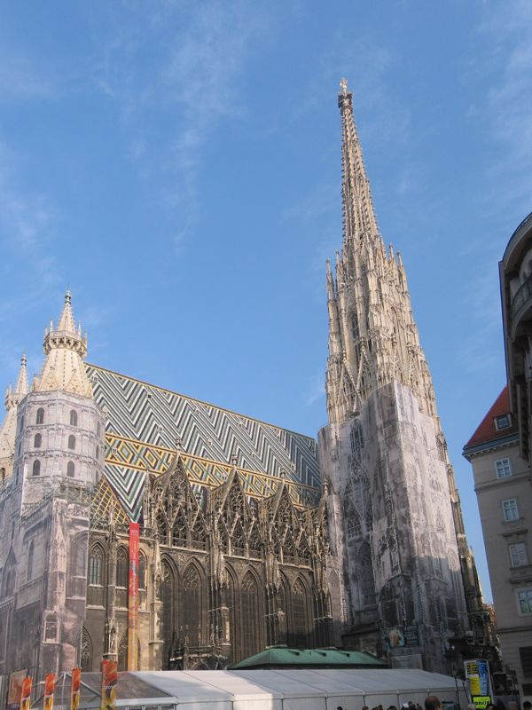
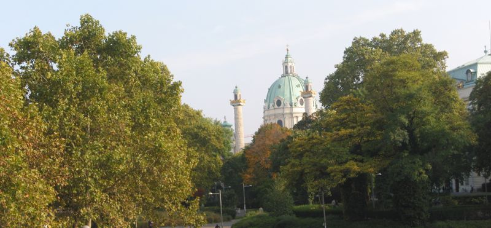
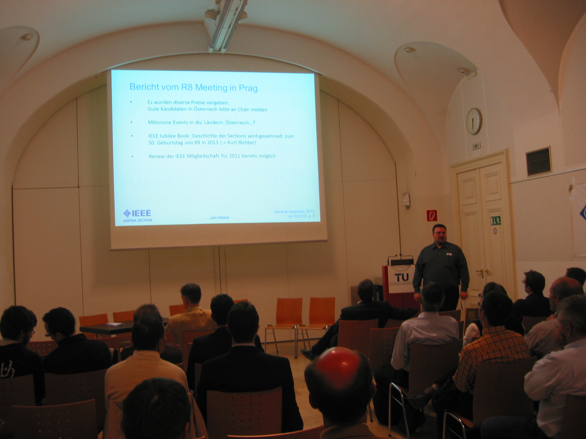

Yesterday we had the IEEE Austrian Section general assembly. I managed to be in Vienna two hours before the meeting(s) got started. So I had like 1 1/2 hours to walk the city. It was a wonderfull, chilly day in fall. Here's a pic of the opera in Vienna

Wennst in Wien bist musst in Steffl besuchn - When you are in Vienna you have to visit St. Stephan's Cathedral. And I did it:

<!--more-->
After paying my dues to the Steffl i went to Karlskirche, which is right next to the Technical University of Vienna.

Later I met wonderful friends from Graz and Vienna that I acutually had met in Belgium for the first time. The general assembly itself was a very unorganized event and not really exciting.

But I met a lot of new people and so it was worth it. I arrived back home in Linz at 12:00 pm with Andrea already waiting for me.
