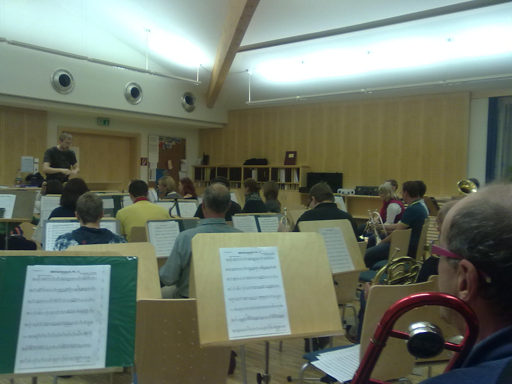
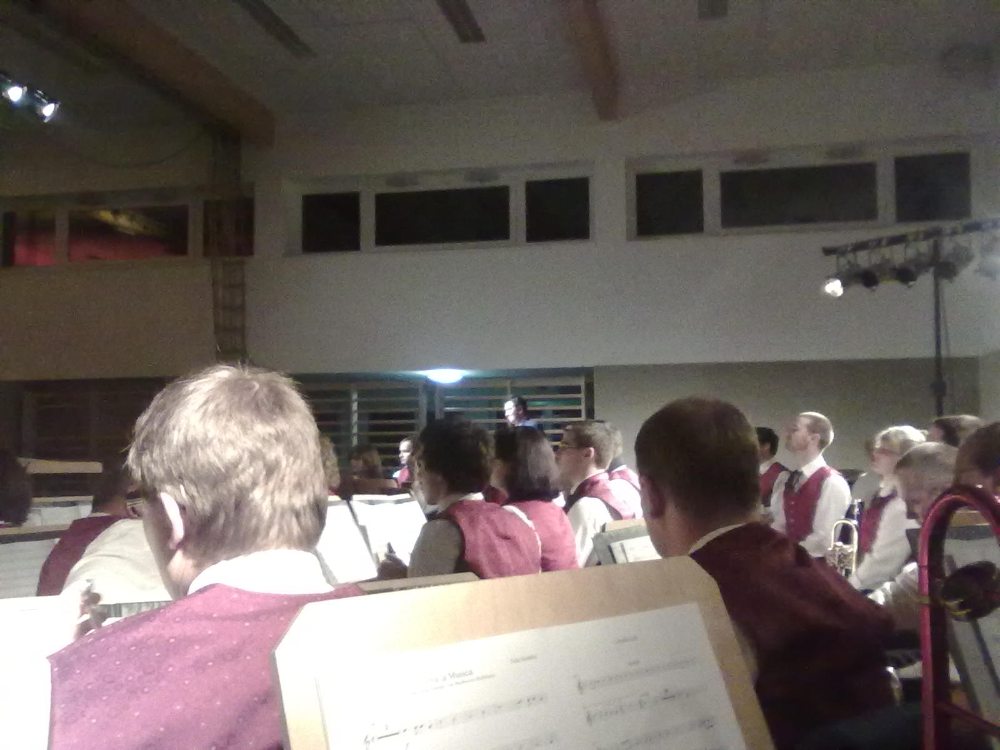
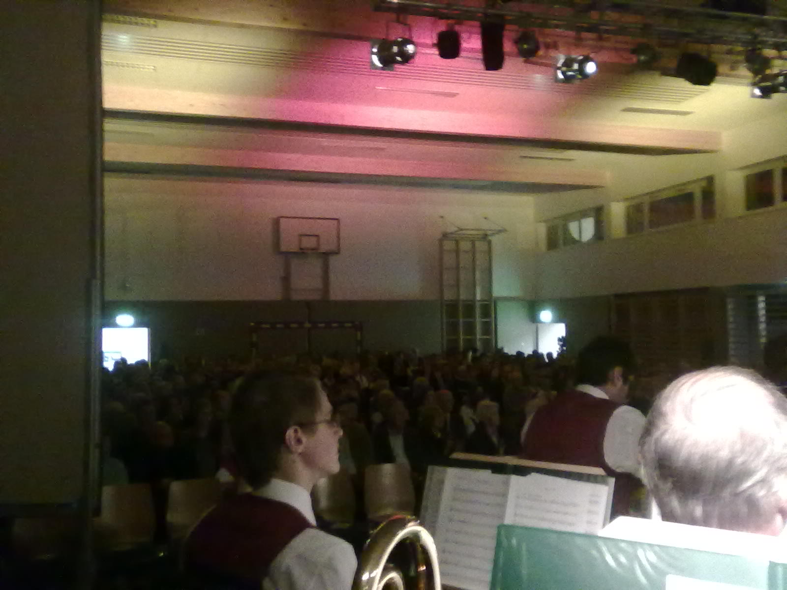

It's a beloved tradition. Once every year we have our fall concert with the Trachtenkappelle Thalheim - a wind band consisting of a bunch of frenetic amateur musicians, such as myself. Some every-Friday rehearsals

led to the final event

<!--more-->

I couldn't resist the temptation to take some pics while the moderator was talking ;) The audience (some 300 people) seemed to like the concert

and so we are all glad and thankful for that wonderful evening. A personal highlight for me was that Andrea and ever her parents came to listen. Thank you and thanks to all of my fellow musicians for their efforts!

Being part of the Herbstkonzert 2010 of the Trachtenkapelle Thalheim is a once in a lifetime event! But for all of you who couldn't make it, one year from now, another concert is waiting for us!
