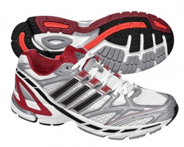
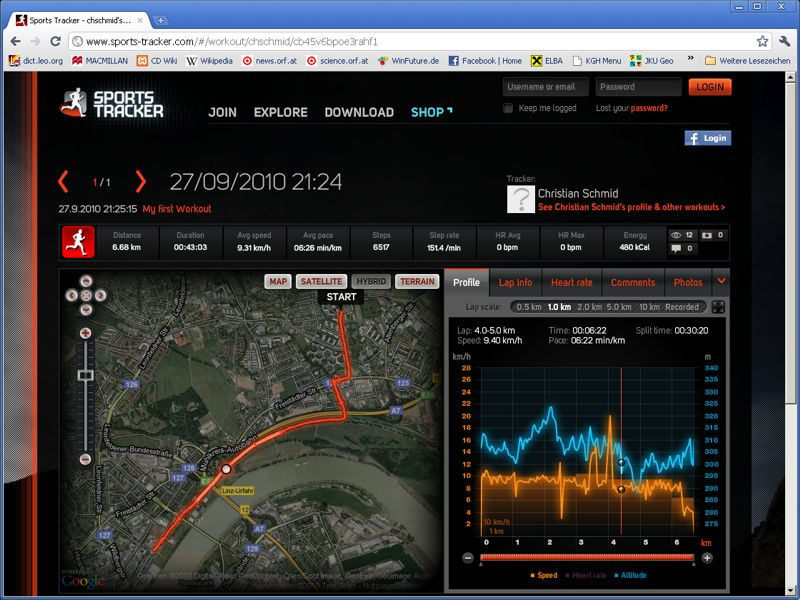

Jetlag and the cold I caught on the airplane from New York delayed it a little bit, but finally I got there: Yesterday I went out for a run, the first time since im back to Austria. What a delight with the new running shoes that I had bought in NYC!

In addition to the new running shoes I tried something else that is new and exciting. As I have a data plan for my mobile now, I downloaded a free program called Sports Tracker that tracks your training! What a fun way to use technology to enhance an every-day thing like running! Check out the stats of yesterdays run at [http://www.sports-tracker.com/#/workout/chschmid/cb45v6bpoe3rahf1](http://www.sports-tracker.com/#/workout/chschmid/cb45v6bpoe3rahf1)

