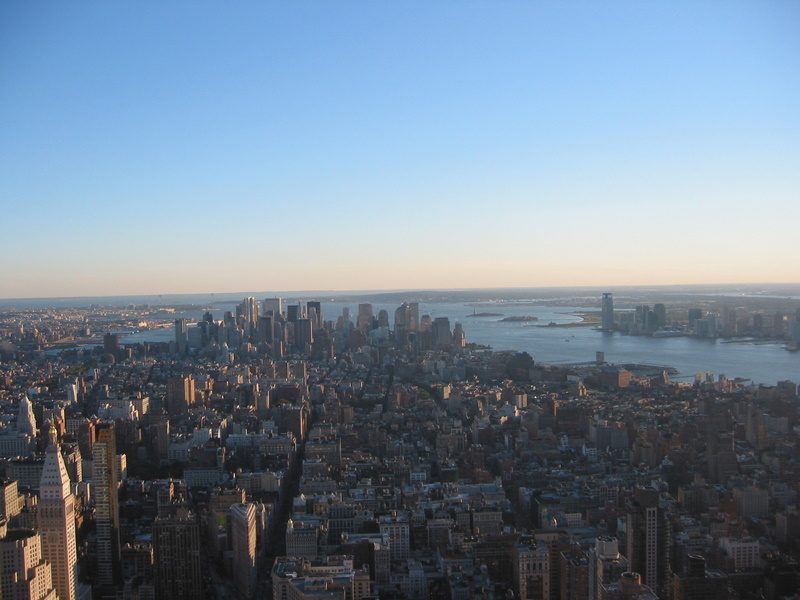
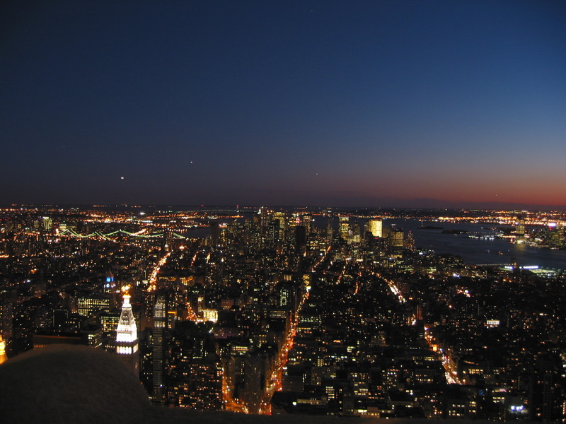
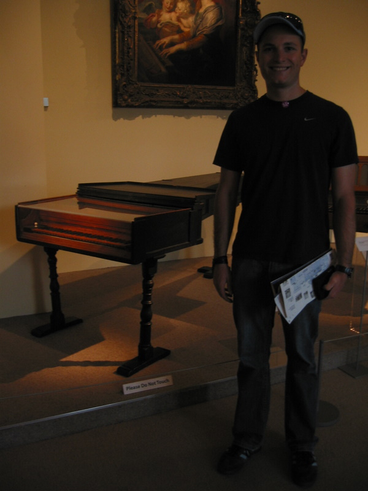

A lot has happend since my last post! New York is an exciting experience. It impossible to compress all the impressions into one blog entry.

Central Park and geocaching therein, the museum of modern arts, Brooklyn bridge, a boat trip around Manhattan island, sun set from the Empire state building, the Metropolitan museum of art, the american museum of natural history, the museum of modern arts, SoHo, little Italy, Chinatown, and so much more, just unbelievable ...

<!--more-->

On thing I am especially thankful for and that I could appreciate more than any other visitor is having seen the Cristofori piano. It was shocking to see all the people just walk by. This my friends is THE OLDEST PIANO that we know of, created by the inventor of the piano Bartolomeo Cristofori himself!!!!

