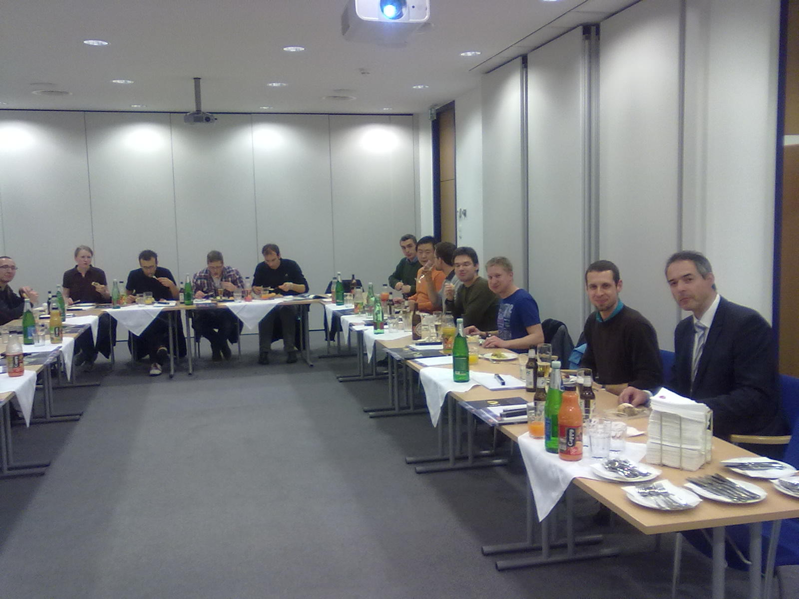
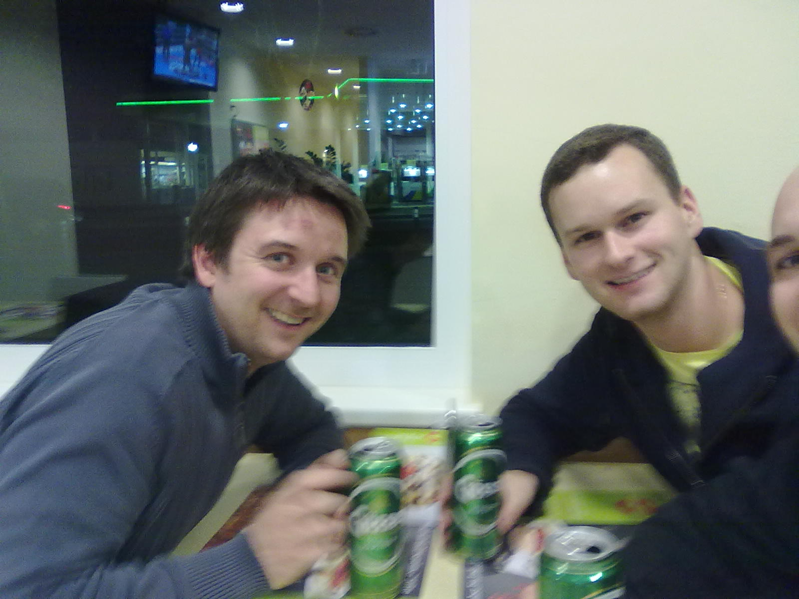

This week was big socializing week. Monday night I attended a panel discussion with Landeshauptmann Pühringer at the KHG Heim Linz, which was pretty interesting. Tuesday evening was the Mechatroniker Stammtisch where I got to talk to some old friends that I hadn't talked to in ages.

Wednesday was the IEEE Student Branch, JKU Linz excursion to ZIZALA Lichtsysteme ([www.zkw.at)](www.zkw.at). That really was a highlight. For starters I guess I just like the people in our group so much! They are such a great bunch people who are motivated, eager to explore, committed, a lot of fun ...

The food was also awesome! Here's a photo of the CEO of ZIZALA and our group:

<!--more-->
It did not end there! Thursday night some colleagues and I decided to give the new Schnitzelhaus around the corner a try. To not get an overly guilty conscience because of the fat food all the time I had to go for a "Schnitzelhaus run" first ([http://www.sports-tracker.com/#/workout/chschmid/aooetr4u9gakg2ev](http://www.sports-tracker.com/#/workout/chschmid/aooetr4u9gakg2ev)) but finally we did it. That the three of us at the Schnitzelhaus:

Well, guess what it did not end there either, yesterday my friend Hari came by to work on his website ([www.haribaumgartner.com](www.haribaumgartner.com)) and later I had a rehearsal with our wind band (which did not work out, as some just didn't show up). Today was IEEE Austria section proposal writing day, and I hope that I can clear out my head by running before I'll go to a dance with Andrea and some friends of hers tonight ...

While socializing can be rewarding it can also be pretty exhausting sometimes, I'm really looking forward to an evening of just ... well ... nothing ...
