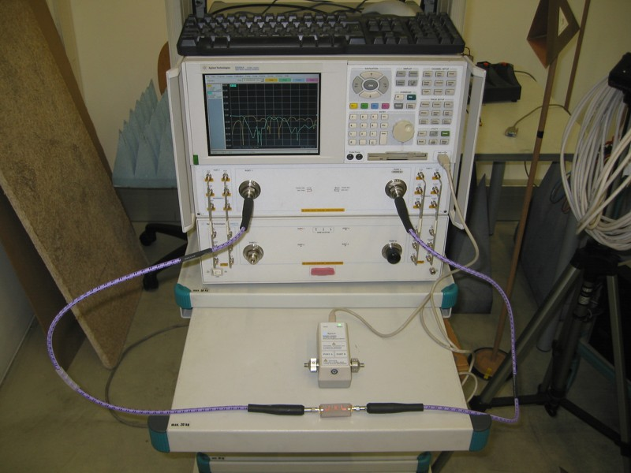
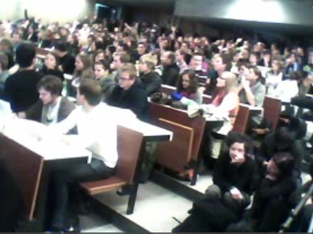
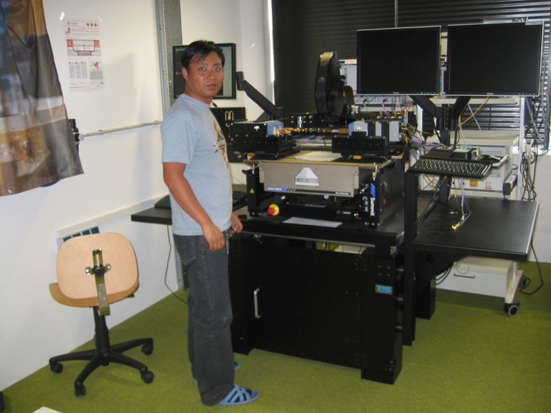
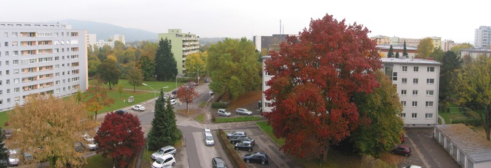

Have you ever designed a microstrip filter and measured it? No? Today I had the pleasure to take some measurements for my advisor. Nothing fancy, just some measurement data he needs for a lecture on Thursday.

I took measurements up to 25 GHz, but being a 77-GHz guy it didn't really bother me. The electronic cal-kit is really cool tough, you don't have to do anything yourself! After lunch, we went to the university assembly concerning the university budget situation. The government is cutting university budgets and by means of this assembly students, faculty and staff are trying to make their voices heard.
<!--more-->
It was an interesting thing to be part of. The panel discussion was really interesting, primarily not for its contents, but for trying to understand it. I don't want to get overly political, but I think the main problem of something like this assembly is that you have people with sooooo many different backgrounds. Some are really trying to analyze problems and are trying to find solutions. Others are just there to be against something. And the wild mixture of different ideas makes it really difficult to figure out who belongs to which group. Whatever somebody says the rule seems to be: Tell it as if it were the truth and shout it as loud as possible, this will make people believe you and follow you.

However, as for me, it's really hard to believe a student in his 9th year, blaming the system for everything. And I don't get it why everybody should be allowed to study, let's say, economics, when we know we will just produce unemployed people, while we could identify needs and try to get people there (right now they say it's engineers and doctors, but I don't know whether there is a "scientific" basis for both claims). Of course how to get students into specific areas is another story, some money and clever marketing people could also do the trick instead of admission restrictions.

So here are my two major points of criticism: 1.) I feel like most people "in politics" are not trying to get a scientific base on which they can make their decisions. 2.) There is no room for uncertainty. When somebody makes a claim it is always an ultimate truth.

The problem might be that people do not demand scientific methods in politics, or only to the point where it goes directly into how "to get more votes" ... Whatever, it was interesting being part of it. It was also good to get back to my realms, which was trying to get material properties @ 80 GHz for some material we have a 3D printer for. Thanks to Kurt it was really easy to handle the 400 K€ machinery!

I'd like to finish my post with a totally different story, namely the story told by the trees of winter approaching at an unbelievably high speed.

So get yourself a cup of tea, a warm blanket and enjoy the last days of fall!
