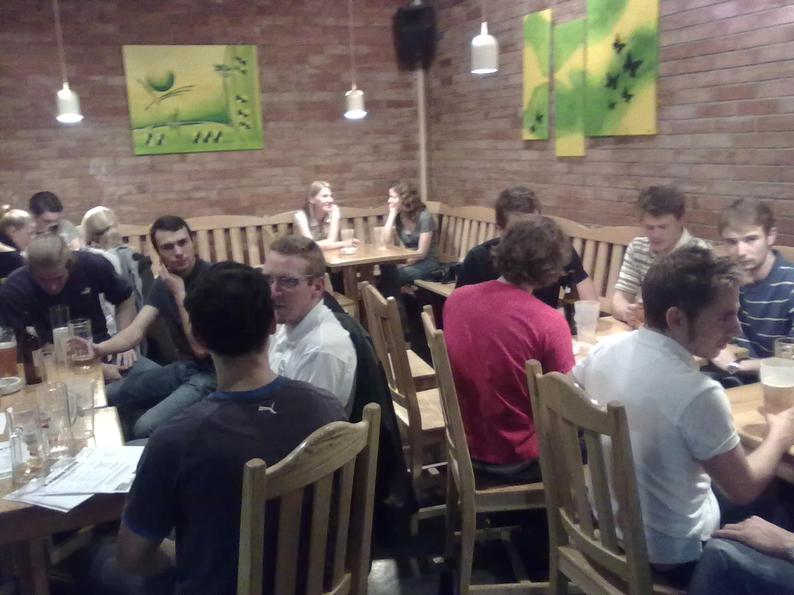
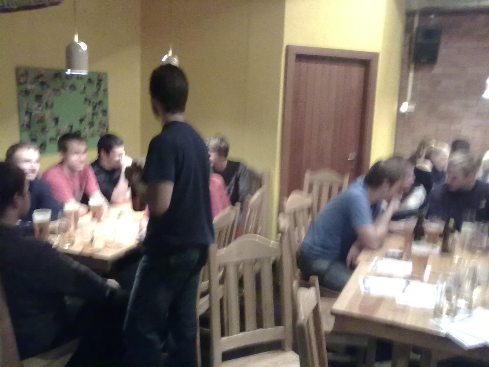
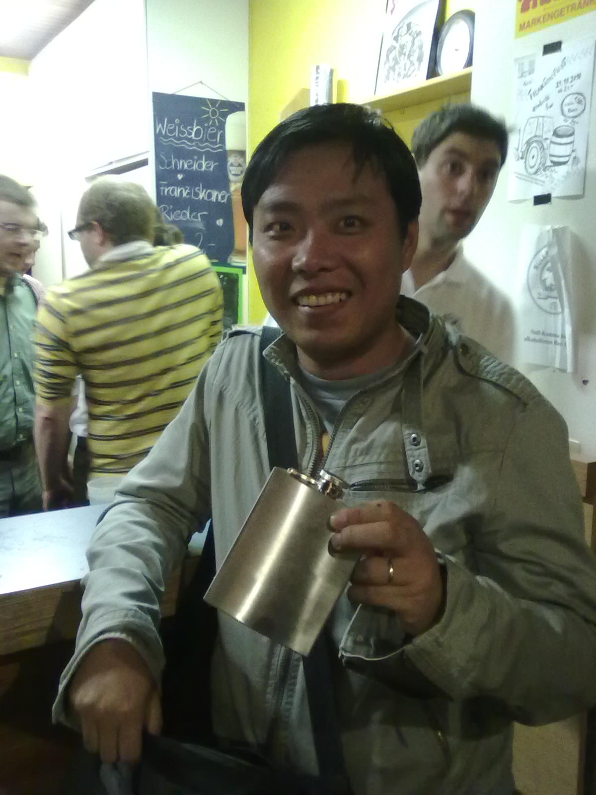
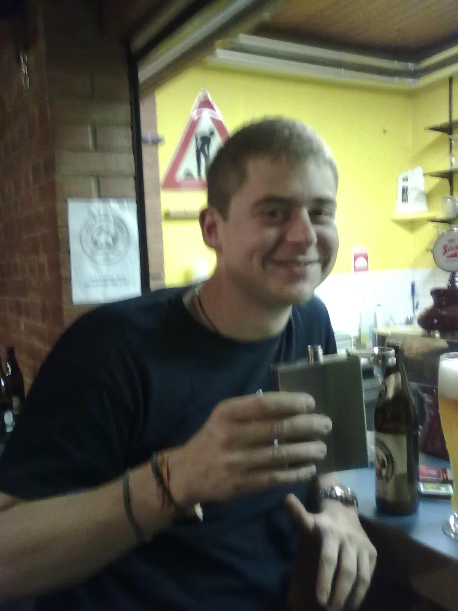
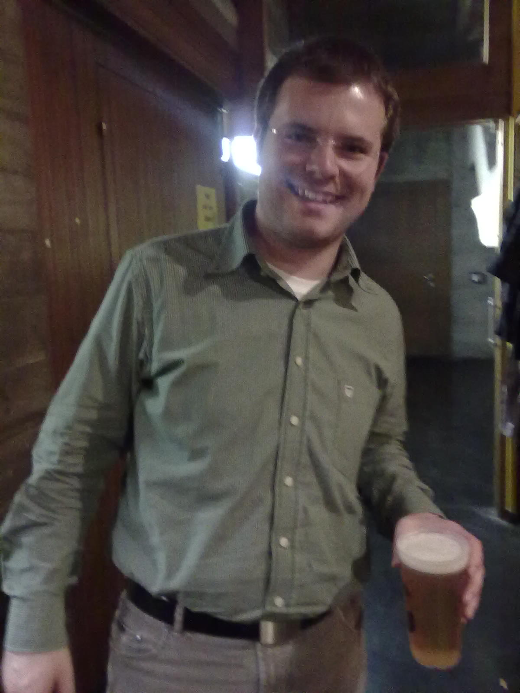
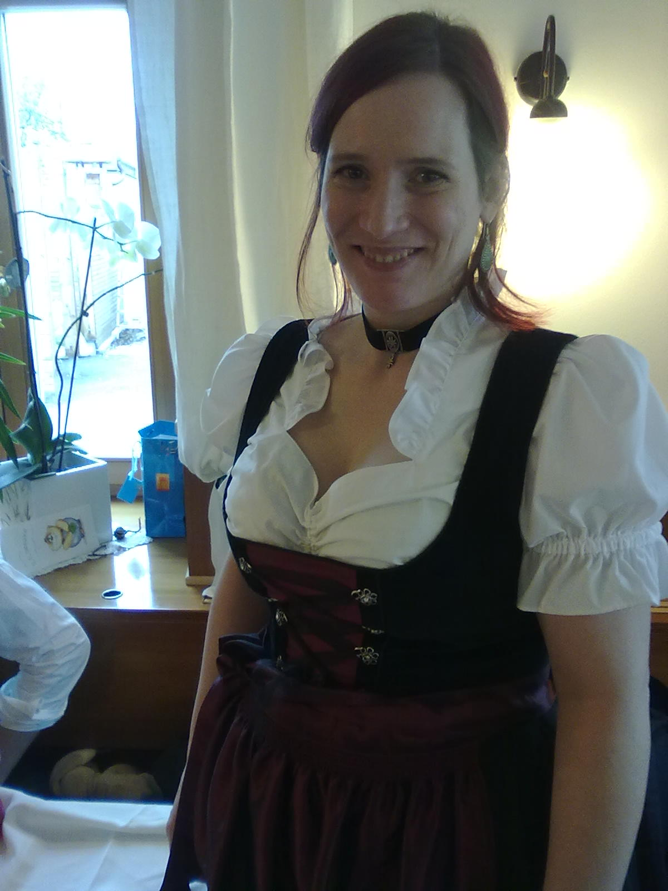
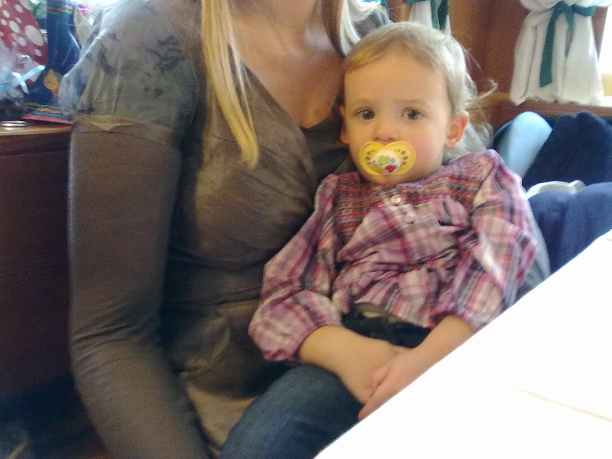

A lot has happened this week, and while crap keeps piling up on one end it is worth while to become aware of the good things that just don't stop happening on the other end. Tuesday night was engineering night, the Mechatroniker Stammtsich took place at the KHG Kellerbar, so let me introduce to you, the future of engineering!

Both pics are a little blurry, but I guess that's because these people are so dynamic and energetic! It was the perfect occasion to grab some beer and some pizza with Kurt, David and Daniel! I just couldn't believe it when Kurt pulled out some Snaps!!! He told me it's important to have something at hand to warm yourself as winter approaches.

<!--more-->
Let me tell you, these people really know how to rock! I just made one mistake, I did not stop there, but went to Wolfi's birthday party after KHG Kellerbar. I gotta admit: I'm getting too old for that stuff, coming home at 4 am I gave my body a really hard time! Talking about seeing good friends: This weekend was heavily music burdened. We had a lot of rehearsals with our local wind band, and one thing that I am especially happy about is that I had the chance to make some music with my best friend Birgit from Salzburg. We did some songs for the christening of one of her nephews. I just love her voice, I will never get it why she did not go into studying music!

Also meet her wonderful daughter Fiona:

I guess it's enough now for this "people's post". Thank you everybody for being part of it!
