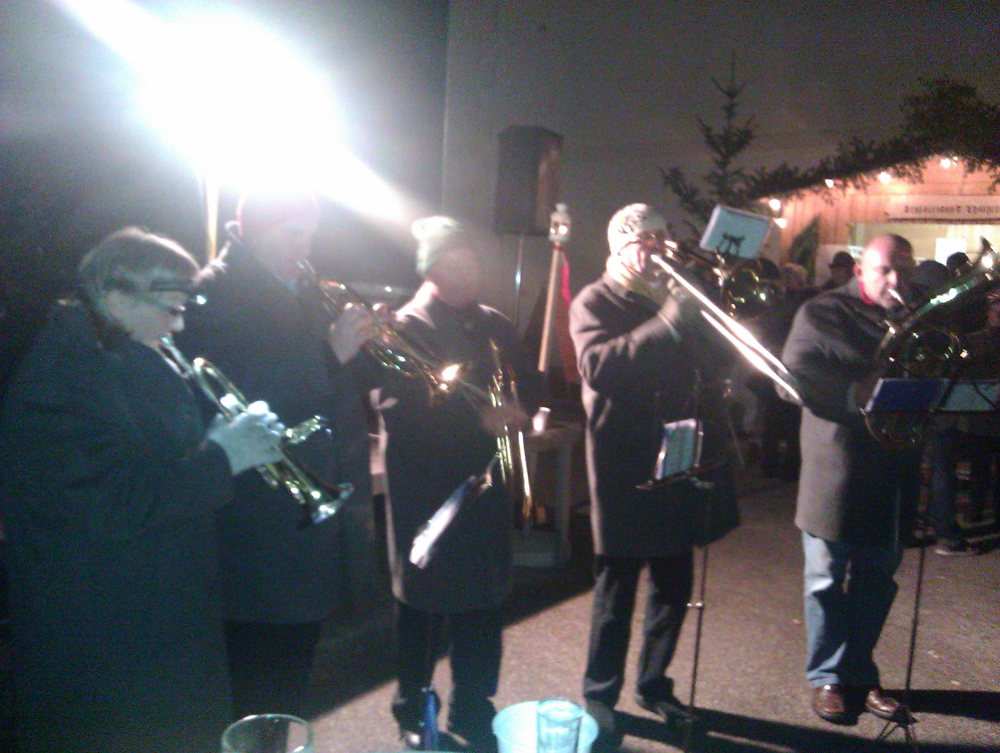
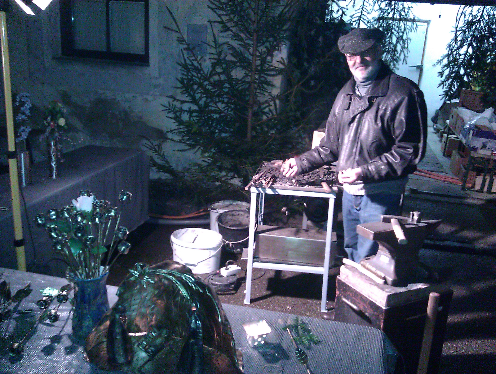
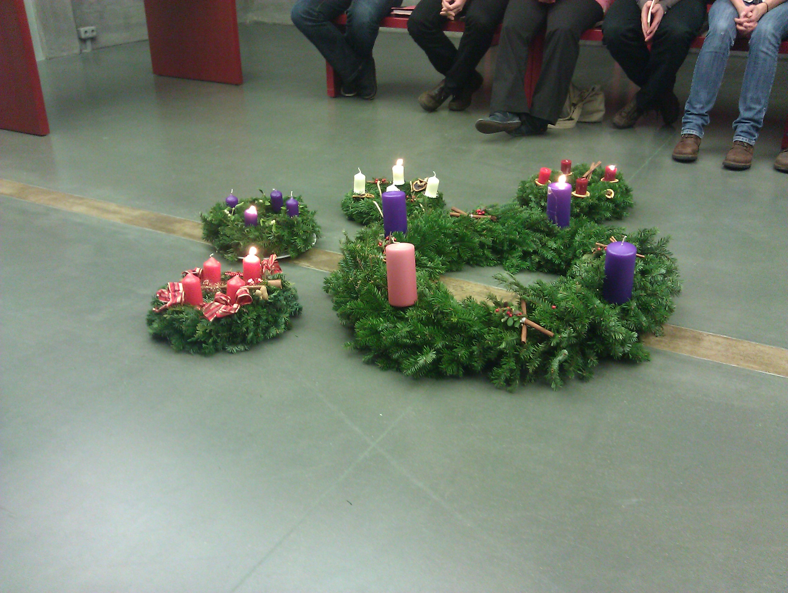

Every year on Advent Sunday, one of the most magical times in the year gets kick off. And it gets kicked off properly. We have this wonderful market where all the groups from my village, such as the firefighters, the farmers, the sports teams sell x-masy foods and stuff to people. In addition we, from the wind band, play x-mas tunes

and craftsmen show how they build stuff using ancient and traditional ways. My father is a blacksmith and he really brings that special feel, with fire and the sound of the hammer to the market.

The day ended with the KHJ night mass which concluded a really spiritual start into one of the most magical times of the year. So get yourself an advent wreath and enjoy it!

