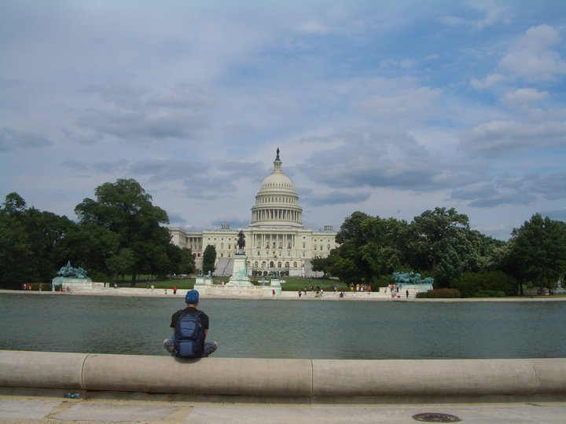

Actually I've been back for over a week now, but there was so much to do - I just couldn't find the time to blog about what turned out to be a really great trip! What was it all about?

1 week of work at the IEEE MTT-S International Microwave Symposium 2011 in Baltimore. It totally overwhelmed me. Waaaay too much information. While I usually tend to end up in a deadlock when there's too much to do I'm glad I was there. One of the greatest parts was seeing my old UCLA friend Darren again! It's always good to see him and I really enjoy his company having a talk over some coffee or at the free-beer-industry-reception.

My talk went well I guess, another highlight was that Reinhard, on of my closes colleagues here in Austria got the Microwave Prize 2o11, which really is an amazing thing and one of the highest honors the IEEE MTT-S has to offer! Congrats Reini!

Apart from that it was aaaalll crazy. I was a student volunteer guarding doors and helping people wherever I could for two days, I was hopping sessions, raiding the exhibition, talking to old friends, meeting new ones ... ... Too much information for a small man like myself.

The 4-days Washington trip that followed Baltimore was the necessary vacation I needed. The great thing: We were a group of three EEs from my university and one from the company that we work with. As for Florian, I already knew that he would be great company from our trip to Singapore, but Herbert's and Reini's company turned out to be just as enjoyable! What a great trip.

Apart from all the things that you certainly have to do and see when you're in DC I enjoyed the Smithsonian Air and Space the most. Actually Becca, a cool-all-crazy nerd girl I met at the IMS told me we would have to go there! I can still feel the goose bumps that I got when I was standing right next to the command module of the Apollo 11 mission. - I could not help it, I was just awestruck.

So long and thanks for all the fish.
