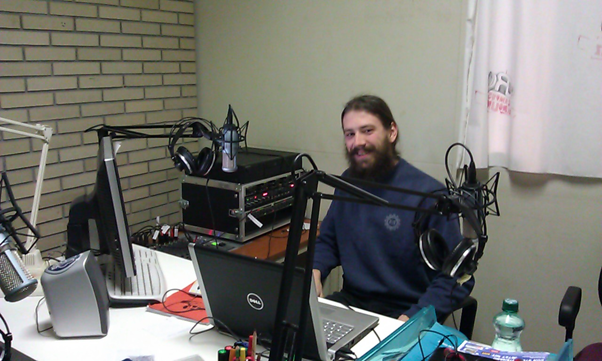

Today I was part of another example of how much you can do with so little. I was live and online on JKU campus radio ([http://radio.oeh.jku.at](http://radio.oeh.jku.at/)). Gerhard, the host of the show I was invited to, is really doing a great job every week! So here's a photo of Mr. The-Show-Must-Go-On

He plays a lot of really cool Austrian music and his comments on politics and what is going on all over the world are hilarious. So if you feel like it, just tune in on [http://radio.oeh.jku.at](http://radio.oeh.jku.at/) every Monday night at 7 pm MESZ (=5 pm UTC).

P.S. You can also download this Mondays podcast at [http://radio.oeh.jku.at](http://radio.oeh.jku.at/). Just click on the show "Der verlorene Posten"
