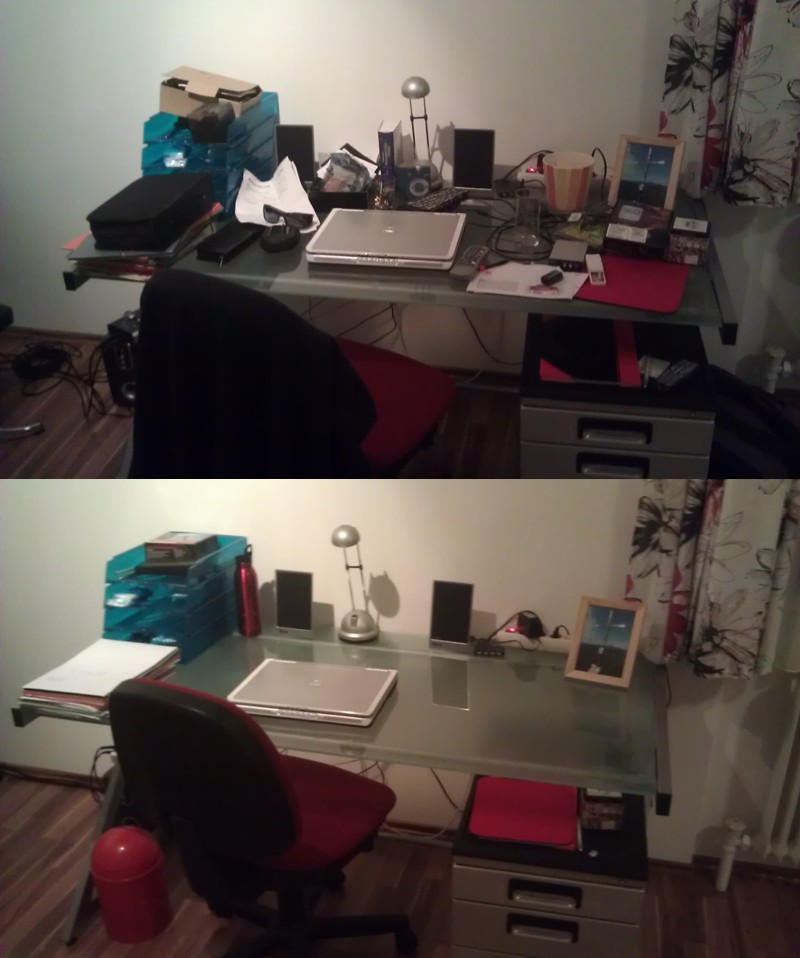

In radar systems the term clutter refers to unwanted components in a radar signal that usually come from unwanted reflections. Say, if you want to track a ship reflections from the sea or from rain are unwanted as they obscure your ability to see what you actually want to see - the ship. The problem is still subject to research and there is even people who devote most of their time to reducing the effects of clutter.

While the problem is so easy to describe and so easy to see in radar systems, I think most of us, including me, have the same problem in different forms in our own lives. Too much stuff around that obscures our view on the things that we actually want or should focus on. On top of that we usually do not devote most of our time to how to resolve these issues. These days it even seems luxurious to think about that kind of things, let alone to let go off the stuff that we don't even have time to identify as clutter.

From time to time I take a day off, just like today, to clean out a little part of my life. Today it was parts of my appartment. The rule: "Don't think too long before you throw stuff out". While it might seem a little bit rigorous at first glance, I can say, it has not failed me yet. To show you what I mean. Here's my table before and after de-cluttering.

Interestingly enough I did even add something during the process of de-cluttering - a bottle of water, we never get enough water they say ...

I think I should be doing more de-cluttering, and I am not only talking about my table. After all you can only write on a blank page, not on a full one, right? What do you think about clutter, how much do you have in your life. Does it obstruct you, or is it what makes life more lifelike?
