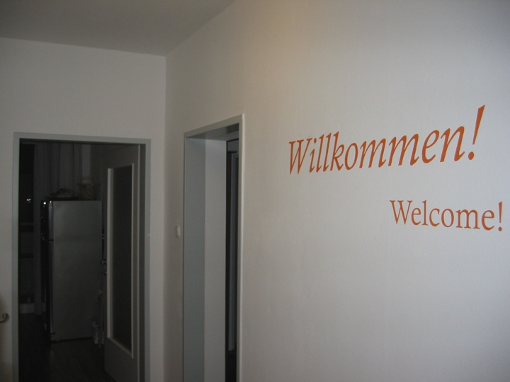
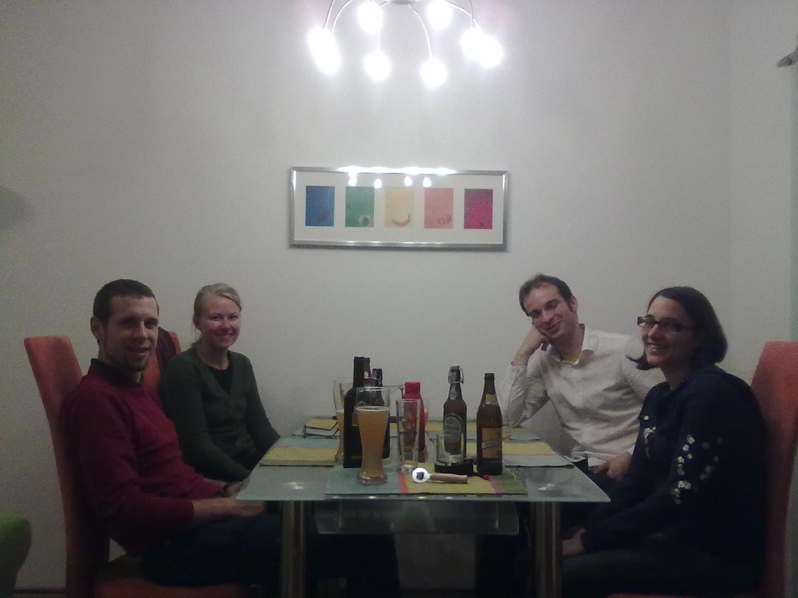

Long time no see! Sorry, I was pretty busy. I still am, but hey once in a while you gotta take a break!

This week was home improvement week,  some repairs here and there, new glass walls in my kitchen, and because Andrea always reminds me that my apartment looks to much like a guy's place (no decoration and stuff) we decided what to do with the big plain wall in the entrance area. We ended up painting the German word "Willkommen!"  and the English translation "Welcome!" onto the  wall in big, orange letters (1 m=3.5 feet length!). Here's photo of the result

... and another one with my sister, her boyfriend, another friend of hers and Richard. Notice of the self-made fruits picture in the back!

Lots of decoration work is still to come! Hope that we can "Welcome!" some of you soon, so that you can take a real life look at our pieces of art!
