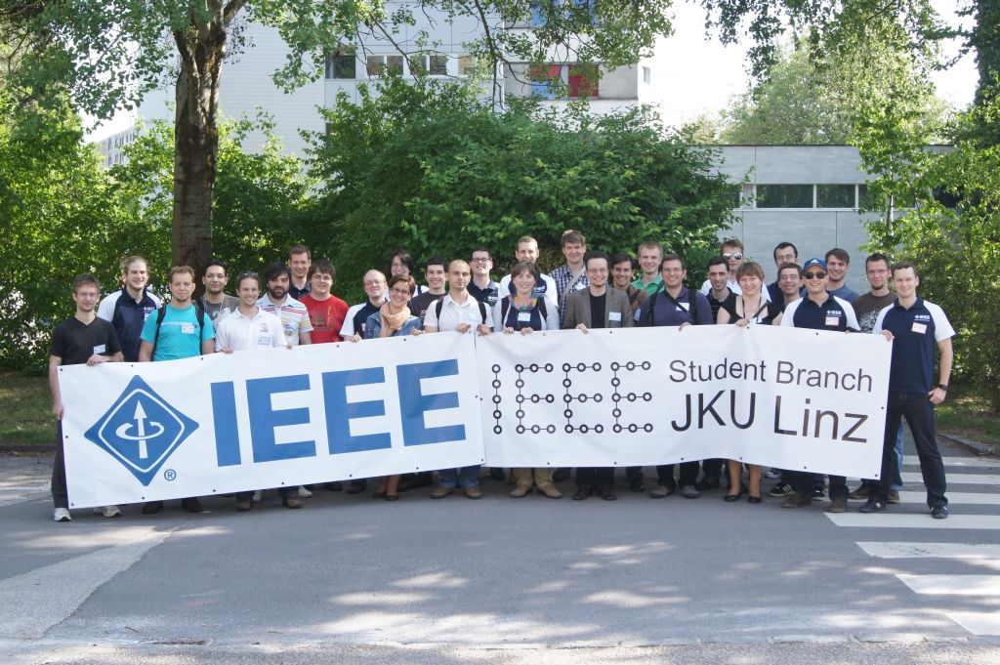

Long time no hear. I was quite busy lately, but it was worth it. We, the IEEE Student Branch, JKU Linz, hosted the very first edition of the IEEE Central European Student Branch Congress (CEuSBC) in May! We had 40 participants from Austria, the Czech Republic, Croatia, Germany, Poland, Portugal and Slovenia. Apart from interesting talks about different engineering related topics, we also had fun social activities and the feedback we got from the participants was amazing!!! You guys rock!!!

Also thanks a lot to the people who made this possible, especially to the local IEEE Student Branch, JKU Linz executive comittee:

Norbert Eidenberger  
Gregor Gerstorfer  
Werner Scheiblhofer  
Jochen Schrattenecker

and to the IEEE people who supported this event:

Manfred Sampl  
Eva  Lang

Piotr from Poland already told me that the Opole student branch would like to host the 2nd CEuSBC in 2013! Go for it!!!!
