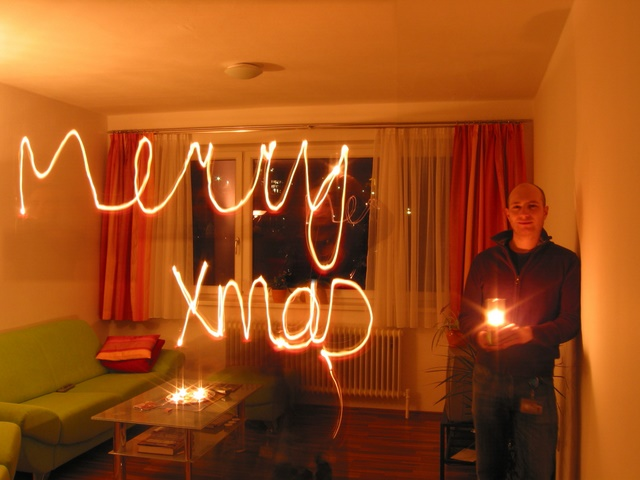

Log time no see. First of all I'd like to wish you all the best for the new year. Here's a photo that I made to share my Christmas wishes!

Christmas, as always was about the busiest time of the year. Parties everywhere, finishing up this year's stuff at work, all the last minute things that you could have done long before ...

But then came  the long awaited Christmas holidays. Time to relax a little bit, read books, come up with good new year's resolutions and do the things that you would usually not have time for.

There's one holiday project in particular that I'd like to show to you:

<a class="yt-embed" href="https://www.youtube.com/watch?v=UGeru-bNizE" data-youtube="UGeru-bNizE" title="TI Chronos (MSP430) Controlling My Bedroom Light"></a>

I had a lot of fun doing that and really enjoyed the time of late night programming that the holidays allowed me to take. It would be great to hear from you what you think about it. If anyone wants such a system too, I can help you set it up, just drop me a line!

Meanwhile I wish you all the best for 2011 and keep on rocking!
