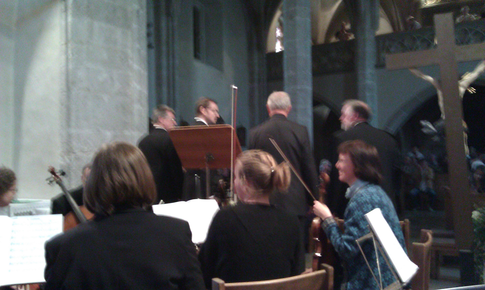
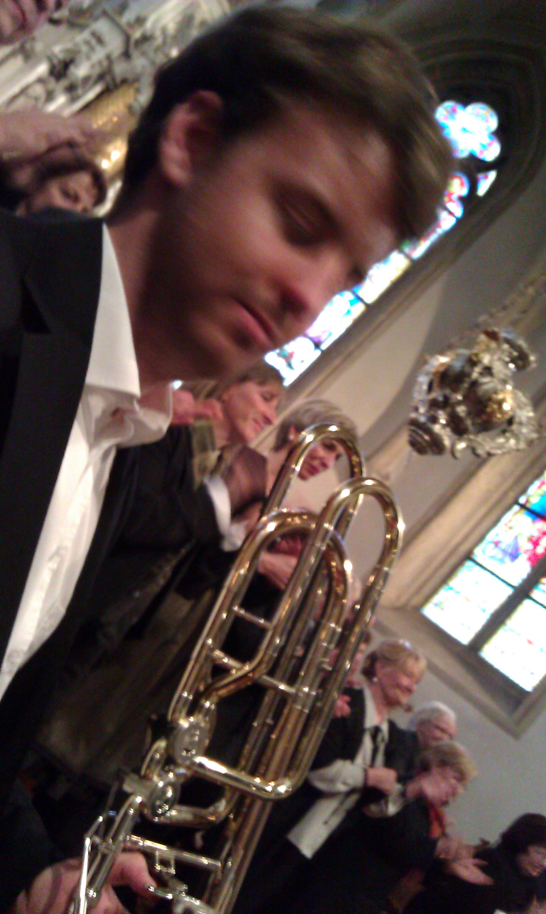
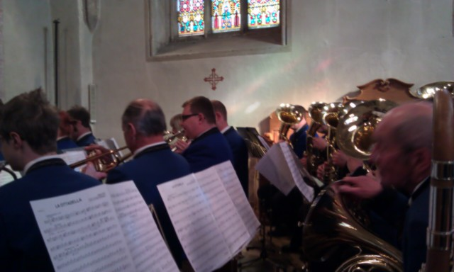

Not of the stuff in this post happened today, but I just realized that I've never really shared any of the music stuff going on in my life on my blog so far.

The first photo I took like 2 weeks ago when we performed the St. John Passion composed by Hubert Hanghofer, a local composer, with a small orchestra, a huge choir and some really good soloists (Franz Kalchmair [http://en.wikipedia.org/wiki/Franz\_Kalchmair](http://en.wikipedia.org/wiki/Franz_Kalchmair), Herbert Scheiböck, ...)  While I have to admit that I don't like all of Hubert's compositions, I have to say that his Passion is a really great piece of art. While interesting musically it has the perfect balance between words and music.

<!--more-->
I also met Agnes again, an old friend from junior high school (she played the chello). She is an archeologist now - wow, my first encounter with a real "Indiana Jones"-kind of person!!! Today was another concert at our church which we played with our local wind band, here's another photo:

The third facet of my music that I'd like to share in this post is my piano version of "If You Could Read My Mind" which I played and recorded about 2 month ago. It's not very fancy and I did not care too much about the quality of my playing, but I still like it.

[If You Could Read My Mind](http://www.chschmid.com/media/ifyoucou.mp3)  

[Listen to the audio](http://www.chschmid.com/media/ifyoucou.mp3)

Somehow it makes me miss the times when I studied piano at Anton Bruckner University. You know the kind of strange feeling you have about something beautiful that you had to let go. There is not too much regret in it but a certain form of nostalgia.

What are the things that you miss? What's in your nostalgia closet? What are we supposed to do with these things?
