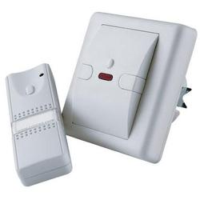
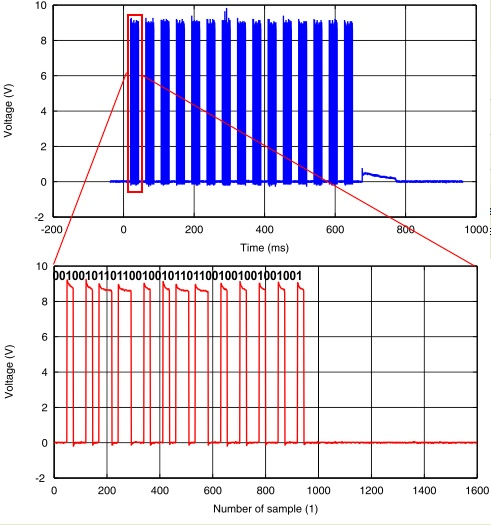
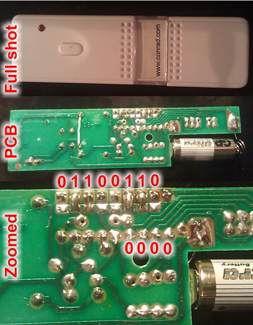
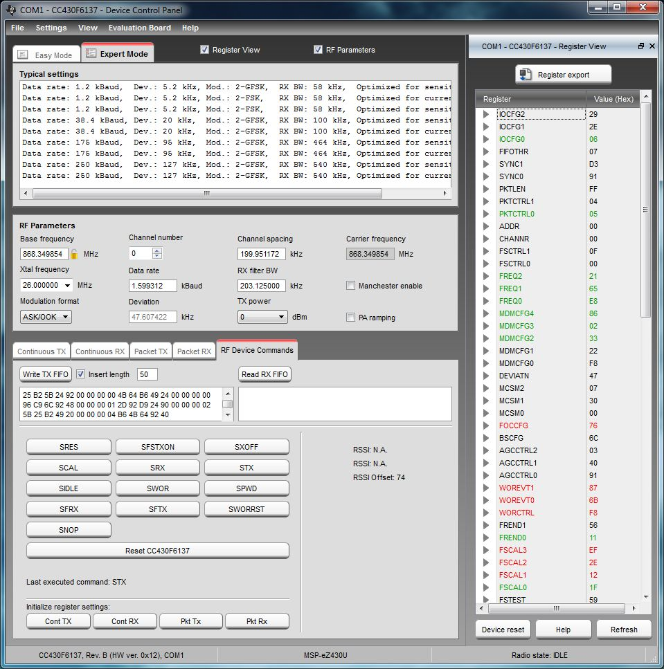

I use my [TI chronos watch](http://www.ti.com/chronos) to control my bedroom light. This post contains information on how the whole thing evolved and how it works. To get a rough idea about the project you might want to watch the short video below.

<a class="yt-embed" href="https://www.youtube.com/watch?v=UGeru-bNizE" data-youtube="UGeru-bNizE" title="TI Chronos (MSP430) Controlling My Bedroom Light"></a>

<!--more-->
## Table of Contents

[1\. Introduction](#1-introduction)  
    [1.1 The Story Behind the Project](#11-the-story-behind-the-project)  
    [1.2 The Hardware](#12-the-hardware)  
[2\. Reverse Engineering the Communication](#2-reverse-engineering-the-communication)  
[3\. TI SmartRF Studio](#3-ti-smartrf-studio)  
[4\. Code Composer Studio: C Code](#4-code-composer-studio-c-code)

## 1\. Introduction

### 1.1 The Story Behind the Project

I installed a dimmer in my bedroom about a year ago. It comes with a remote control that allows you to switch the light on and off, as well as to dim the light. About two month ago ordered the TI chronos.

Hey wait a minute: They both operate at 868 MHz. So it should be possible to make the TI chronos control the dimmer. Well, the idea was born, now it was time to knuckle down ;)

### 1.2 The Hardware

This project combines

-   the TI chronos ([http://www.ti.com/chronos](http://www.ti.com/chronos))
-   and a dimmer from Conrad Electronics /[http://www.conrad.at/ce/de/product/620587/Funk-Lichtschalter-mit-Sender](http://www.conrad.at/ce/de/product/620587/Funk-Lichtschalter-mit-Sender)).

The TI chronos comes with a very detailed documentation and also Conrad even provides a schematics for the dimmer (Click links below).

-   [TI chronos user’s guide](/files/2011/01/SLAU292a.pdf)
-   [Dimmer user’s guide](/files/2011/01/620587-an-02-ml-FUNKLICHTSCHALTER_SENDER_de_en_fr_nl.pdf)
-   [Dimmer schematics](/files/2011/01/620587-sp-01-en-K_LICHTSCHALTER_MIT_SENDER.pdf)

The dimmer comes with a remote control which allows to switch light on and off. If the button on the remote is held down, instead of pressed just once, the brightness can be adjusted.

## 2\. Reverse Engineering the Communication

The goal is to emulate the signals sent by the remote control with the TI chronos watch. Therefore the first step is to characterize the RF signal transmitted by the remote control. The problem can be tackle using two approaches. One can either try and understand the schematics provided above or one can perform measurements. The schematic has one flaw, that is it does not describe the RF module, so no information about the modulation scheme, packet format and so on.

Thus I went with the measurements first. A session at the spectrum analyzer and a 10 GS/s oscilloscope soon showed the commands are sent using OOK (On/Off shift keying) at a carrier frequency of 868.35 MHz. The signal that goes into the RF module simply turns an SAW oscillator on and off. The chip that is used to generate the transmit data is a HT12E encoder ([http://www.holtek.com/english/docum/consumer/2\_12e.htm](http://www.holtek.com/english/docum/consumer/2_12e.htm)). As long as the button is pressed the encoder generates a signal that is repeated periodically. The following figures show the signal as measured with an oscilloscope.

It turned out that a minimum of 6 code cycles are required for the dimmer to switch the light on and off. If more code cycles are transmitted the brightness starts to change.

The exact code generated by the encoder is hardwired into the remote control by soldering, as can be seen below (click to enlarge).

The last four bits are always zero but the first eight bits are set by soldering at the encoder’s pins. The encoder prepends a zero and then generates a stream of three bits for every single input bit (a total of 3+8\*3+4\*3=39 bits) which are then transmitted by the TX module (see oscilloscope plots above and, which matches the code of the remote in the photo). I now even have two dimmers in my apartment, no measurements were required for the second dimmer, as the code can be read from the soldering.

[Click here](/files/2011/01/TI-Chronos---Conrad-Dimmer.zip) to download a zip file that contains measurement data and MATLAB code to extract the data to be sent by the TI chronos. Simply run “runDataExtraction.m”. “runEncodeData.m” will produce the hex code for a given solder mask.

## 3\. TI SmartRF Studio

Now it is time to test the code obtained from [2\. Reverse Engineering the Communication](#2-reverse-engineering-the-communication) with the TI chronos to see weather it works or not. I just connected the chronos to the computer via the debug interface and started TI SmartRF Studio ([http://focus.ti.com/docs/toolsw/folders/print/smartrftm-studio.html](http://focus.ti.com/docs/toolsw/folders/print/smartrftm-studio.html))

First I used the “Packet TX” mode, after adjusting all the required RF settings suddenly, like magic, the light turned on and off. In a next step I tried the “RF Device Commands” mode. This is a little bit trickier, you have to set all the strobes yourself. At first it did not work as I never used the FSCAL strob, but then I found the following routine to be working:

1\. Initialize register settings: Press “Pkt TX” button  
2\. Set the RF parameters to your requirements, in my case (click to enlarge):

3\. Write TX FIFO (Write data to TX FIFO)  
4\. SCAL Strobe (Calibrate PLL)  
5\. STX Strobe (Transmit the command)

Tada, the light goes on or off every time STX strobe is set. After the first run, you can skip 1 and 2, just loop 3-4. Now it was time to export the register settings for the C code to be implemented in [4\. Code Composer Studio: C Code](#4-code-composer-studio-c-code), so I enabled the register view and used the “Register Export” feature. Which format works best for you depends on how you write your C program.

## 4\. Code Composer Studio: C Code

What can I say, here’s the complete source code: [download source code](/files/2011/01/cS_Sports_Watch.zip).

First of all, what are the changes from a user point of view: Compared to the original software there’s not much of a change, only two things: The primary first (L1) and second line (L2) modules (the ones that show the time and the date) loose their secondary view mode. So the up and down keys will no longer show the seconds or the year. But come on: Who needs to know what year it is, or the exact second. Instead these buttons will cause the two codes for my two dimmers to be transmitted.

Now to the code point of view: The two new files are cSLight.c and cSLight.c. Actually they implement another L2 mode. But I did not activate it, as modifying the buttons for the two main L1 and L2 modes seemed a better idea. Besides the obvious things needed to implement the L2 mode and to modify the main L2 and L2 modes I changed the Strobe function in rf1a.c. I don’t know if it is actually needed, but I found more recent CC430 rf1a code on the TI website, which actually seemed more reasonable – so I replaced the function that comes with the chronos.
