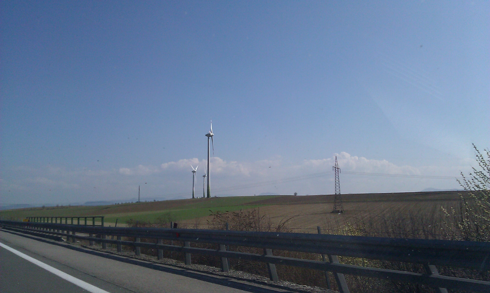
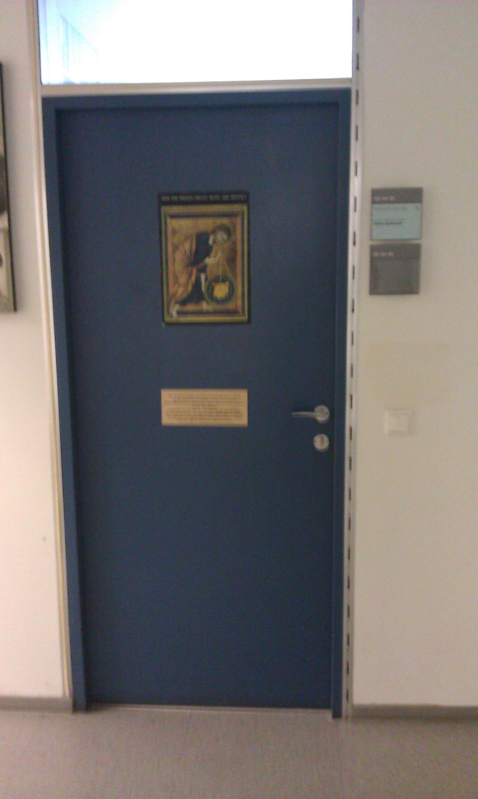
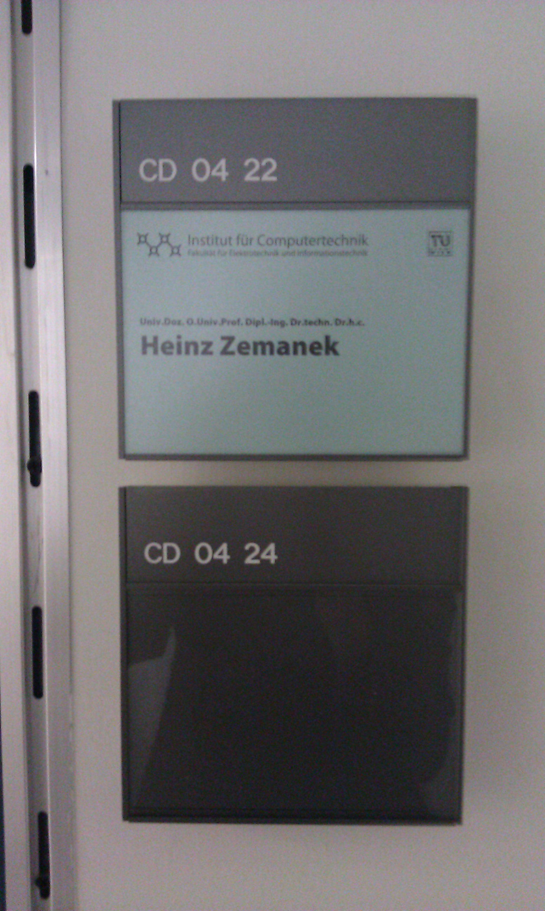

Another visit to Vienna. Apart from the IEEE Officiers meeting, which was quite interesting, I have two other interesting findings to share! It was a really great day with lots of sunshine, so driving was fun. What I came to realize is that we have a lot of wind power plants in Austria:

Whatever this means, I think I like it ;) Secondly, while on a short break from the meeting, I realized that we had the meeting right next to Heinz Zemaneks office (http://en.m.wikipedia.org/wiki/Heinz\_Zemanek)!!!! Yes, the famous Mailüfterl (http://en.m.wikipedia.org/wiki/Mail%C3%BCfterl) Zemanek ;)

All in all it was a great day!
