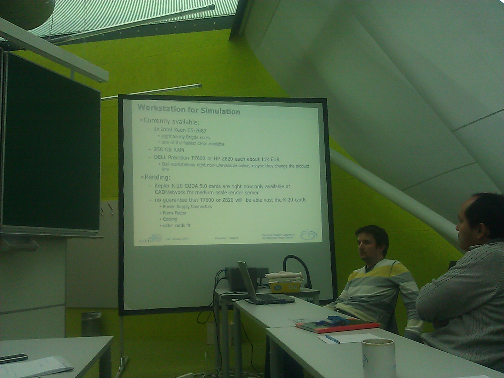
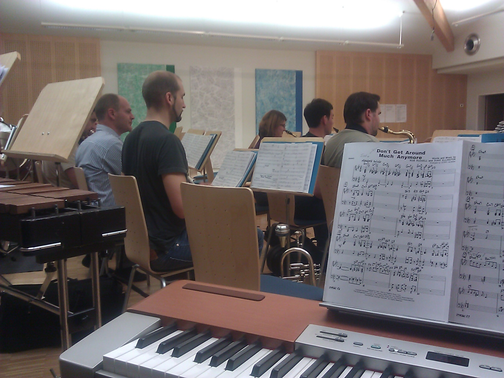
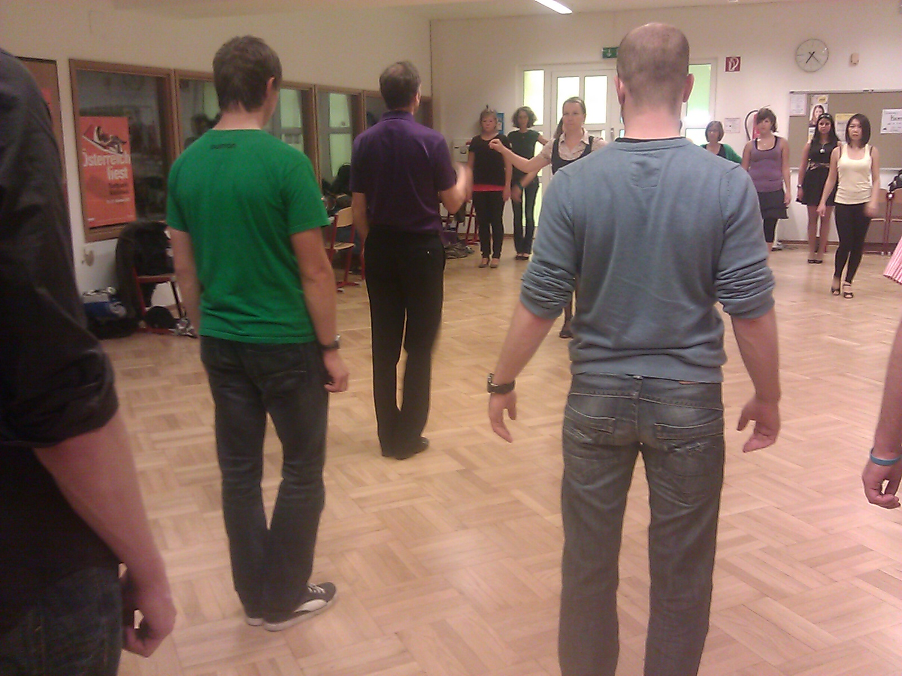

The very first 48 hours of this week. Congratulations to all of us who've made it that far.

Just a quick update from my side (all times are [CET](http://en.wikipedia.org/wiki/Central_European_Time) [military time](http://en.wikipedia.org/wiki/Military_time#Military_time))

Monday 10/22/2012

7:00 - 9:00: Preparation of the presentation for our lab meeting

9:00 - 12:00: Lab meeting. Due to the [NDA](http://en.wikipedia.org/wiki/Non-disclosure_agreement) we are all bound to, just a quick, innocent photo of the new EM simulation setup that we think of buying

12:00 - 12:30 Lunch

12:30 - 18:00 CST simulations

18:00 - 19:00 Quick run + shower. You can see my track here [http://www.sports-tracker.com/#/workout/chschmid/3o0ipvuvhlftmuql](http://www.sports-tracker.com/#/workout/chschmid/3o0ipvuvhlftmuql)

19:00 - 20:00 Driving to Wels

20:00 - 22:00 Musikverein Thalheim Big Band Rehearsal: People have often asked me why they don't read about negative things in my blog. So here's one: I simply hate this Musikverein Thalheim Big Band Project. If you want my honest opinion about it: there's no musical value in it and for me it is just a pure waste of time. Why do I not just quit it: Because it is also a social obligation. Here a photo shot from my perspective behind the piano

22:20 - 23:00 Driving back to Linz

Tuesday 10/23/2012

8:00 - 17:00 Work as usual (CST, reading papers, discussing problems, lunch ... )

17:00 - 18:00 Going home, showering, commuting.

18:00 - 19:30 Dancing lessons. Please don't tell her, but I am really grateful that Andrea insisted on taking this dancing class that we go to once a week! - It is really precious quality time that we spend together!

20:00 - 20:30 Reviewing some IEEE public relations articles + sending some e-mails.

20:30 - 22:30 Mechatroniker Stammtisch @ KHG Kellerbar. This is where you meet all the Mechatronics undergrads and a great place for recruiting new members for our [research group](http://nthfs.jku.at/) as well as for the [IEEE Student Branch](http://ewh.ieee.org/sb/austria/jkul/). It is really good to see that there are so many motivated engineering students at JKU! Thank you guys, you've made my day.

23:00 - ? Blogging

I'll log off now, time to go to bed, let's build a new radar system tomorrow!
