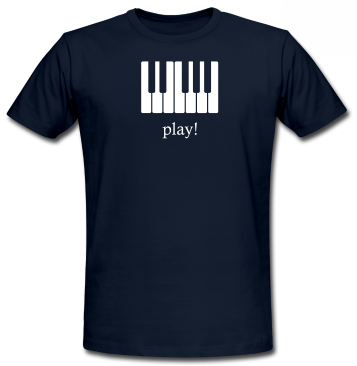

Everybody is talking about it right now, and I'd like to share a personal story about something that has happened to me recently. But first of all the video:

<a class="yt-embed" href="https://www.youtube.com/watch?v=N8Xg_C2YmG0" data-youtube="N8Xg_C2YmG0" title="What Is ACTA ?"></a>

So here's my story: I love doing "DIY" projects. I create my own music, I build things (see the projects page), and I also like designing my own clothes. About 4 months ago I created a T-shirt with a piano keyboard and the word "play!" written below it:

I thought it would be fun and tried to have it manufactured by an online shop. My design got rejected - twice! You know why: "Because using the word "play" on any kind of clothing is registered to a company called playtex": [http://register.dpma.de/DPMAregister/marke/register/800248/DE](http://register.dpma.de/DPMAregister/marke/register/800248/DE)

Yes, it is true, you can register a single, common English word, so that nobody, absolutely nobody else, is allowed to put it on any kind of clothing - no matter in what context, no matter in what size or font. Isn't that horrible. I surely don't want the same thing to happen in too many other parts of my life!!!!!!!!!!!!!!!!!!

Do you have any personal stories? What do you think about ACTA? Post a comment, twitter, chat, talk about it!

By the way: The design slipped through at another online shop ;) So you can order it at [http://www.spreadshirt.at/play-C4408A17629509](http://www.spreadshirt.at/play-C4408A17629509)
