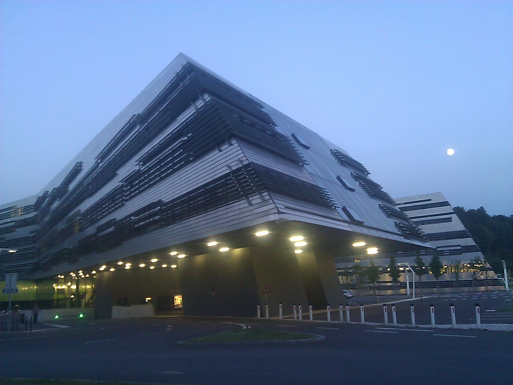

Hordes of students swamping the campus. Loooong lines in the cafeteria. The anxiety and excitement of freshmen. People asking me where they would find the building which we are standing right in front of. Yep - school has started again and it's the very first day.

As a PhD student doing research with no teaching obligations this should not affect me in any other way than the ones already mentioned, but with everybody else feeling it I just can not deny the sensation a fresh start. Or more like a caesura for those of us who have been here before. Similar to the new years eve it makes you reflect on what there is to come. Don't get me wrong: I've given up on the concept of resolutions long ago. I rather make plans and my plan is to finish my PhD during the next year.

And here's an almost nightly shot of the Science Park, the building where this is going to happen!

