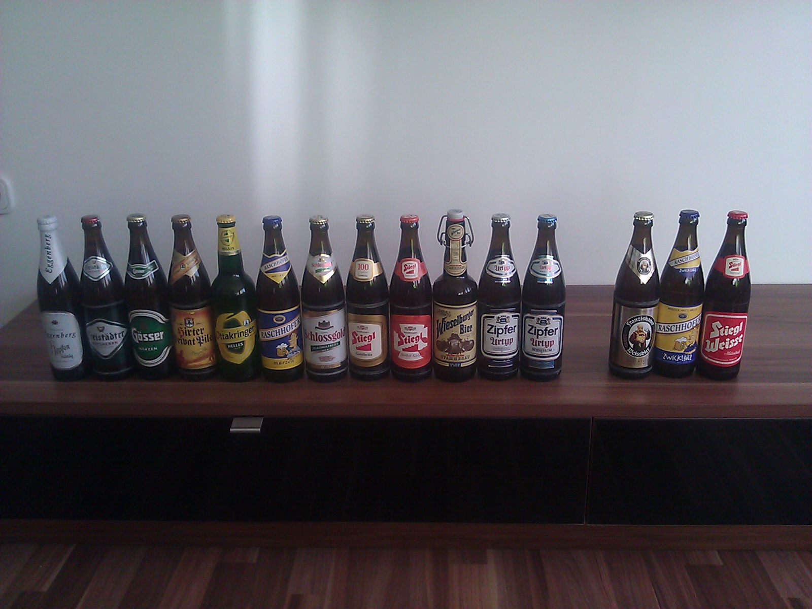
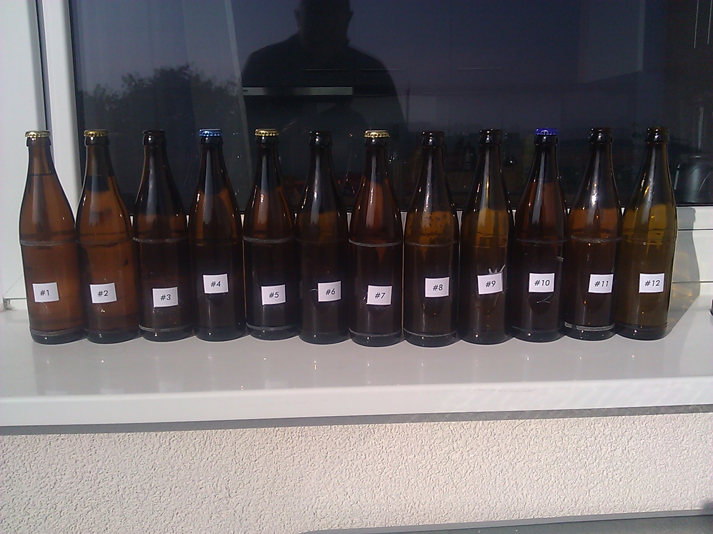
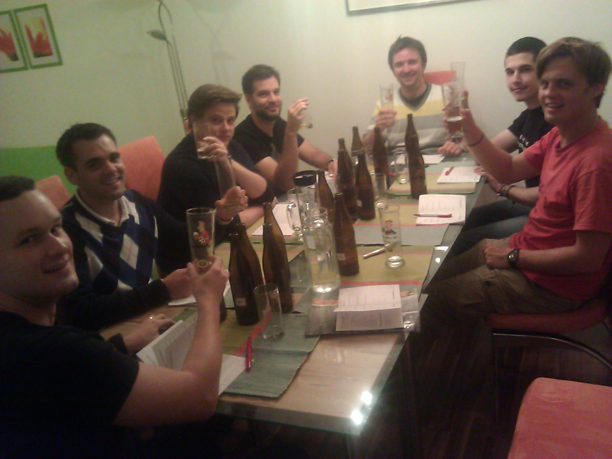
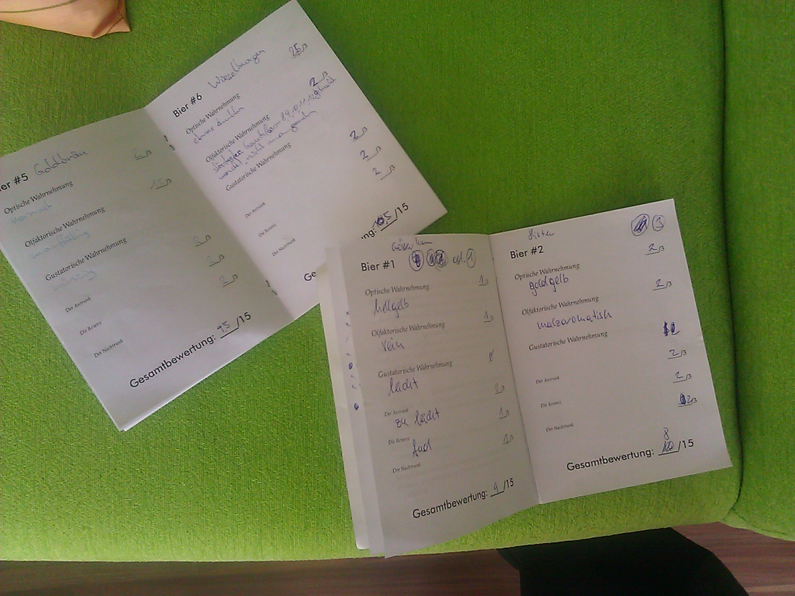

It all started with a simple question "Is des Zipfa wirklich so a Foazgeschwoabat?" - "Is Zipfer beer really so bad after all". Having a scientific background there was just no way around setting up an experiment: 8 experts, 12 different kinds of Austrian beer and a [blind taste test](http://en.wikipedia.org/wiki/Blind_taste_test). Here are some photos before and after I had removed the beer bottle labels

And here's the panel of internationally acclaimed beer and microwave engineering experts ;)

I had prepared booklets where they could rate the different kinds of beers (#1-#12) by using points and words. It blew me away how many suitable adjectives they found for describing the smell, looks and taste of beer.

The results were similarly astonishing. I don't want to bore you with statistics (that's what we had [LibreOffice Calc](http://www.libreoffice.org/) for), so here just some major findings:

1.  Zipfer scored the highest number of points from 2/8 testers -> "Zipfer is do koa so a Foazgschwoabat" - Zipfer beer is not so bad after all.
2.  Only one tester (out of 8!!) successfully identified the non-alcoholic beer Schlossgold
3.  The logical conclusion: Marketing really seems to have a huge influence on our favorite beer choices - more than the obvious parameters looks, smell and taste.

I don't know when, but it was so much fun, I am sure I will do something like this again!!!
