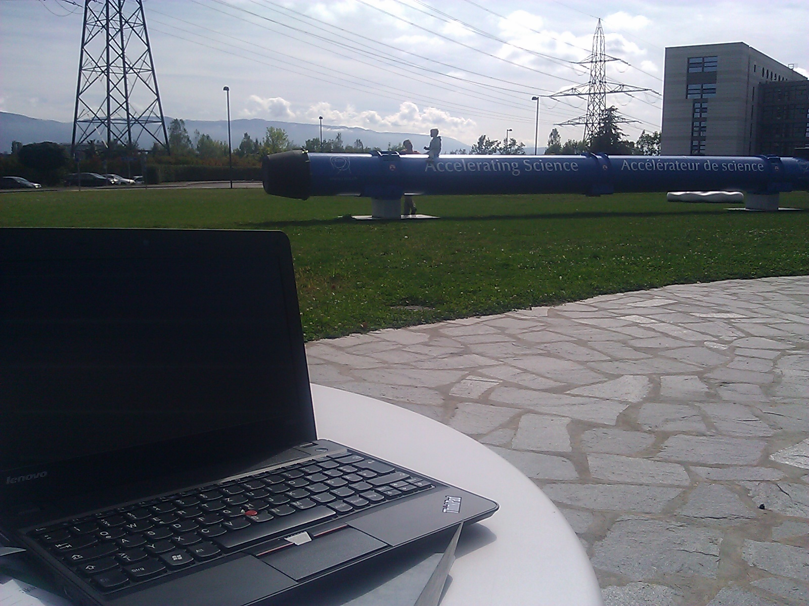
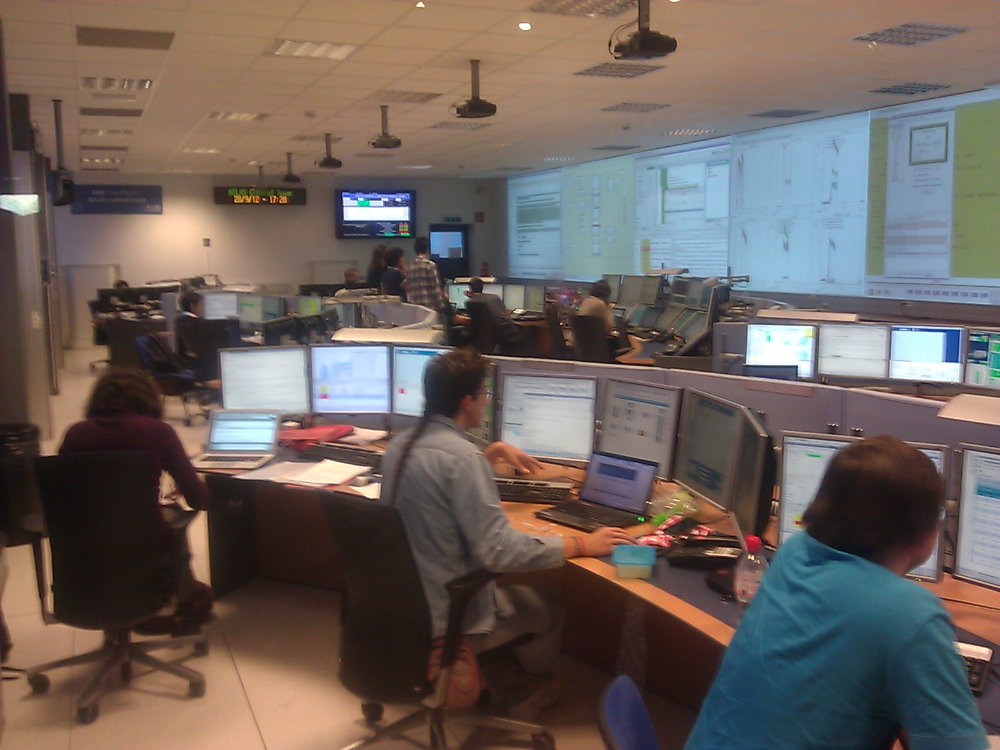
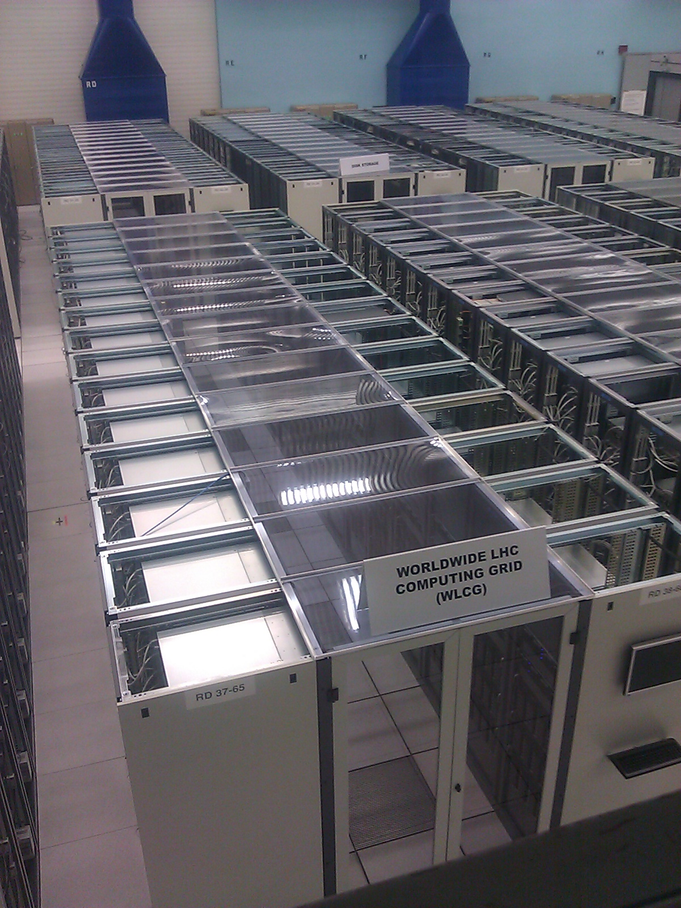

We've made it and it is actually our second day at CERN. I am sitting at a table in the CERN cafeteria, a sunny spot right next to one of their magnets they have on display. More than 1000 of these are somewhere below me, in a 27 km long ring. That's where they accelerate junks of protons to have them finally collide.

As I am sitting here sipping my coffee I enjoy the spirit and the excitement of all of the researchers and “science tourists” around me who have come from all over the world to participate in and witness R&D at the forefront of science and technology!

Yesterday we had the chance to talk to one of the scientists from the core team of the [Neutrino experiment](http://en.wikipedia.org/wiki/OPERA_experiment), where in short they send Muon Neutrinos from CERN to some place in Italy (roughly 730 km from here) to see if some of the Muon Neutrinos change into Tau Neutrinos, as predicted by some theory that is not confirmed yet. I am sure you've heard about that experiment, which was in the media excessively because of some measurement setup error which lead to the suggestion that neutrinos may be faster than light. It's just so much more exciting to really talk to the people who actually do the experiments as opposed to just following some copy-and-paste flawed media coverage by some journalist who might not even care. I'm getting goose bumps again as I think about those interesting discussion!

[ATLAS experiment](http://en.wikipedia.org/wiki/ATLAS_experiment) control room

[LHC](http://en.wikipedia.org/wiki/LHC) computing grid

