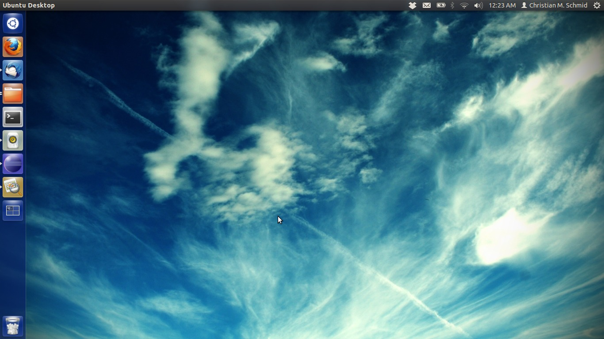

bladder - that's what Sheldon want's to be

PC - me. That's why I started playing again with Linux. I have to admit, the whole Linux thing is with me for more than 10 years now. I have installed at least one Linux distribution every year and after some time found it: unusable to put it mildly. Most importantly: it never really supported my hardware. I should mention that I am talking about the two laptop computers that I've owned.

Which were both bulky 15 inch machines and I decided to go for a smaller computer about a month ago. So here I was with my brand new Lenovo ThinkPad x121e (AMD-450 Version), no operating system. In other words: Another round of Linux tryouts. I decided to try Ubuntu.

It was a lot of work and it involved things that my mother would totally not be capable off, but shit, I gotta say: It has convinced me this time!!! I got everything working!!!

