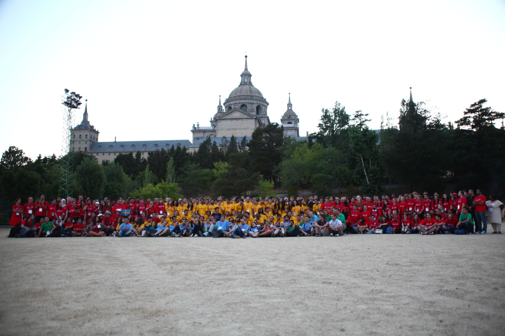

Looking at the amazing amount of blog posts that I've written so far (can you hear the sarcasm?), I guess I'll just have to admit it: I'm not much of a blog writer. So the best I can do right now is to refer you to other blogs.

One that is definitely in my top 10 list of blogs right now is the [blog by the IEEE SB Ljubljana](http://sbcmadrid2012.ieee.si) on the [IEEE SBC 2012](http://www.sbcmadrid.es)! Most of you will probably ask what is IEEE, what is an SBC? The Institute of Electrical and Electronics Engineers (IEEE, read I-Triple-E) is a professional association ... well you can look that up on [wikipedia](http://en.wikipedia.org/wiki/Institute_of_Electrical_and_Electronics_Engineers) yourself. Basically it's a worldwide network / non-profit organization for engineers of all ages, colors, ... and they have Student Branch Congresses (SBCs) every year, where students from all over the world meet to discuss the latest trends in EE and to ... well ... just meet each other. And that is what the [IEEE SB Ljubljana blog](http://sbcmadrid2012.ieee.si) is about.

So here's what I suggest you should do: If you are an engineer and not an IEEE member yet, get a membership NOW and try to get to the next SBC. You can thank me later. What is in it for you is meeting some of the brightest, most inspired, open-minded, innovative people you will find out there, a mix of great minds with cultural backgrounds as diverse as the cities where these events are being held and memories and experiences that you won't forget too quickly.

I was fortunate to write one blog post for my friends from Ljubljana, which you can find at [http://sbcmadrid2012.ieee.si/?p=296](http://sbcmadrid2012.ieee.si/?p=296).

