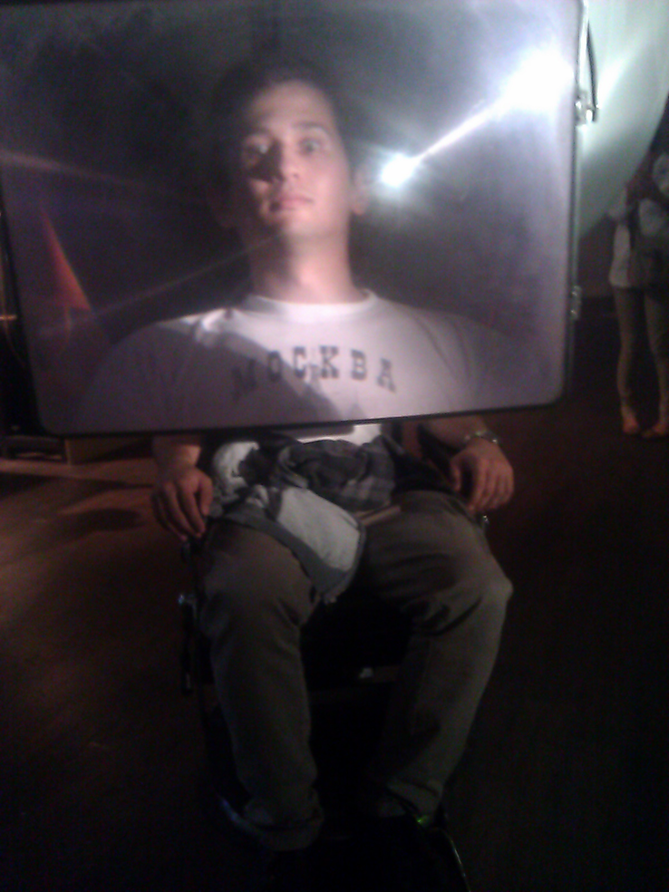

The last three days were marked by the visit of my good friend Christoph Bauer. I know him trough "Pro Scientia" ([http://de.wikipedia.org/wiki/Pro\_Scientia](http://de.wikipedia.org/wiki/Pro_Scientia)) and we've stayed in contact since we first met at the Pro Scientia summer convention about a year ago.

I really enjoyed his visit. Even tough I can not come up with any reasonable explanation, of how anybody his age can have such a broad and mature cultural, political, scientific, you name-it, knowledge, I can say that having conversations with him is one of the greatest delights one can get!

Apart from talking, listening to Bach, Mozart, Wagner, tasting great spirits we also explored some of the cultural highlights Linz has to offer. We managed to get hold of some of the last tickets to the exhibition "Sinnesrausch", which hosts a couple of installations centered around the common theme "Sensory Sensation" and leads over the rooftops of Linz. Most of the installations are interactive, here's a photo of Christoph trying the "super-lense-chair".

If you think that exploring Linz and its wonders is for you too, just drop me a line. I am always happy to welcome my friends to Linz!
