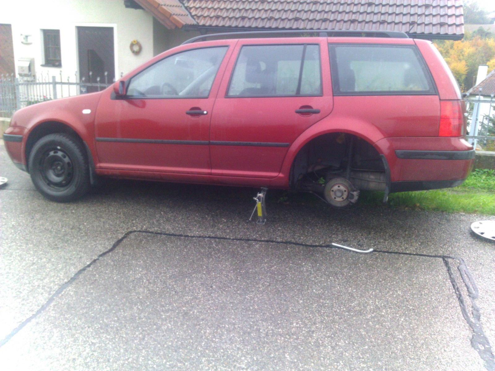
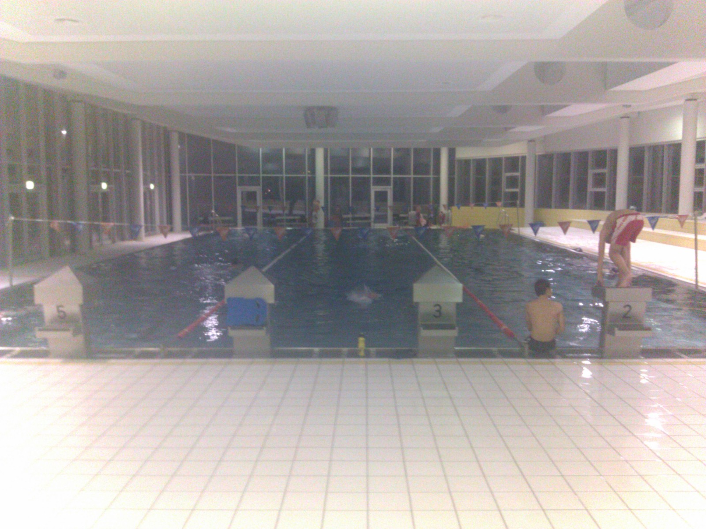
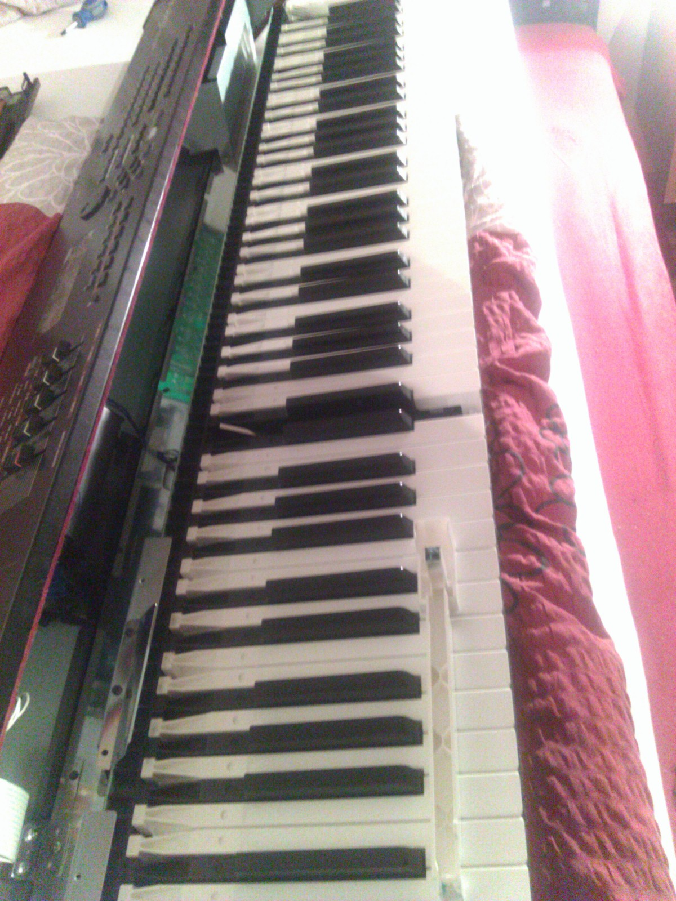
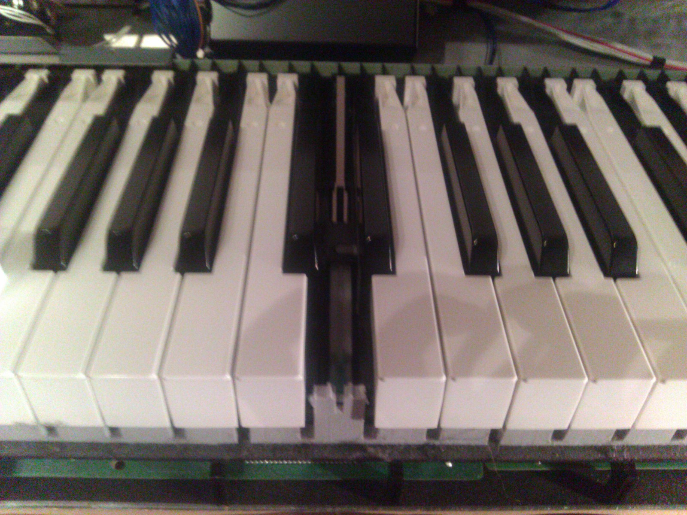

Today was all about maintenance and repair. It started with me mounting the winter tires. Austrian laws require your car to be equipped with winter tires from November 1st in case of ice or snow, which starting with November is to be expected any time.

And lo and behold, we saw our first snow just hours after I had mounted the winter tires! - The perfect weather to go swimming and do some body maintenance.

That's just one of the good things about visiting my parents on weekends: They have this great but underrated resort nearby: The [Welldorado](http://www.wels.at/wels/page/679995597123214884_679996121109225074~680460219705984870_680460219705984870,de.html). Well it's not as big or luxurious as the huge ones, but on Saturdays there is always enough space in the sports pool for doing some lanes. An hour later or so, I was heading back to Linz. At first I wanted to practice piano, but then I decided to stick to the day's main theme. My electric piano is a Yamaha S90 ES, which I really like for it's great piano voices and all the other things that you can do with it. However it is 7 years old now and some keys started to get sticky and the key response began to become uneven. So I decided to open it up and do some cleaning.

You can actually take out every single key to clean or replace it. What is interesting is that the keys did not get sticky because of me or anybody else pouring something over the keyboard (although not aware of me doing so, I had thought that this was the reason). The real source was exuberant grease that Yamaha had used and that had started to creep between the keys. Anyway now the piano plays as smooth as on the very first day!

All in all not much revolutionary happened today. I mainly spent with maintaining and repairing some of my tools. - But this is important, because they are the things that might help me do more exciting stuff someday!
