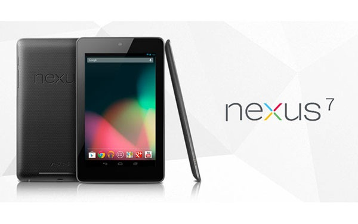

I've really been struggling with the question of whether I should get myself a tablet or not. Everybody is talking about them and many people want one. iPads, Surfaces, Ice Cream Sandwiches, Jelly Beans, you-name-them. Having earned a hundred bucks by publishing my own [Android app](https://play.google.com/store/apps/details?id=com.chschmid.mlconnect), I finally decided to give it a try. It's funny how I do understand now, why I was struggling so hard in the first place. But more on that later.

So what did I get: That one's obvious - a 32GB Nexus 7. It's got enough horsepower, it's reasonably priced and software updates are to be expected at least for the next 18 months + I know how to write programs for Android, so I can come up with my own software (Maybe I'll even write tablet optimized apps someday).

But - you might have guessed that there is going to be a big BUT somewhere - I have one really essential problem with this tablet, which I guess applies to a lot if not to most of the tablets out there. - It even took me to get one to understand this fundamental problem. And here it goes: Tablets and the software they come with right now are designed for content consumption rather than for content creation.

They are perfect for watching movies on the go, for listening to music, for surfing the web, gaming and a lot of other things that involve consuming content. - I did not add reading e-books to the list, because from my own experience I find e-ink e-book readers much more suitable for this purpose. Tablets are also great tools for small tasks, like managing your calendar, reading emails, giving a short reply to e-mails, WiFi calls, as metronome, tuner or for getting public transport information. But truth be told, so are most of today's smartphones.

However when it comes to me wanting to actively create content, like designing a new T-shirt, writing an article, recording some music, writing sheet music, creating software, designing websites, managing my music and e-book libraries, creating presentations or even just printing stuff, they become pretty much useless or badly broken crutches at most. They suck horribly when compared to the fully featured Linux PC that I am sitting in front of right now.

This realization inevitably brings new questions. Why are these things not possible on a tablet? Would it be possible to implement such software for tablets, given the UI constraints? Would we use these kinds of software? You could say: "Well that's just not what it was made for" But then: Do the tablet companies see them as sole consumption devices that we should not use for more? And ultimately: Do tablets have a negative impact on society, as they get more and more of us into consumption rather than into creation mode?

What do you think?

