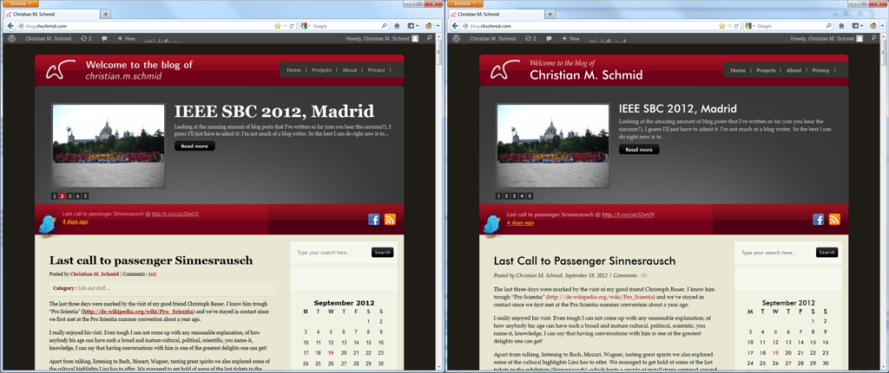

Yay! New fonts for my blog. Here's a photo of the before and after effect (click to enlarge)

Do you notice the fonts that are used now? For quite some time I've actually been using mainly the three typefaces that are now also used on my blog, which are:

-   Futura - it's one of the greatest San Serif fonts I know. I love it for its simplistic geometrical shapes, as well as for its elegent lower case ascenders.
-   Palatino Linotype Regular - actually I am using URW Palladio Regular, which is an Open Source Version of Palatino Linotype. I love it for its beauty and more importantly for its high legibility. By the way I am also going to use this one as main font for my thesis, which is going to be based on [André Miede classicthesis LaTeX package](http://code.google.com/p/classicthesis/).
-   Palatino Linotype Italic - This is probably the most beautiful typeface - ever. It's bad that it is not as legible as its regular version, but hey its soooo beautiful! Just zoom in on this ampersand and you'll know what I am talking about:

&

Of course fonts meeting web involves some technical stuff too, actually quite a lot of it. Just for the sake of completeness I'd like to refer you to [Wikipedia](http://en.wikipedia.org/wiki/Web_typography) and the site that helped me with the font conversion: [http://www.fontsquirrel.com/](http://www.fontsquirrel.com/).

If you want to learn more about about fonts I'd like to recommend  ["Just my type" by Simon Garfield](http://www.simongarfield.com/pages/books/just_my_type.htm), which has paid my bedside table a visit just recently. By the way: What's your most favorite font and why?
