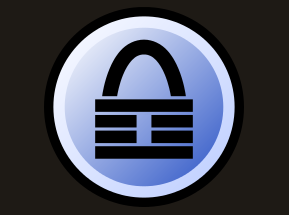

F\*\*\* you IEEE admins! [http://it.slashdot.org/story/12/09/25/1356211/data-breach-reveals-100k-ieeeorg-members-plaintext-passwords](http://it.slashdot.org/story/12/09/25/1356211/data-breach-reveals-100k-ieeeorg-members-plaintext-passwords)

I really don't get it how something like this can happen in an organization that prides itself on being the scientific home to some of the most respected researchers in the field of computer and data security.

Anyway, this incident triggers me to start this new thing that I am going to call "Spotlight", where I'd like to present nice tools, must-haves, must-does and other stuff. In the shadow of recent events I'd like to point out a little program to you called [Keepass](http://keepass.info/).

The problem for many people with a password leak like the one IEEE committed is, that they use just one password for all the services they use. Just one password for twitter, facebook, mail, skype, maybe even credit cards, bank accounts, you-name-it. When one institution leaks your password you are really screwed! On the other hand users often use trivial passwords such as password, 12345, ... , just because they would have to remember so many passwords otherwise. But there is just no way around: You have to use a strong, unique password ([http://en.wikipedia.org/wiki/Password\_strength](http://en.wikipedia.org/wiki/Password_strength)) for every service you use - and you may NOT write it down or store it in plain text!

This is where [Keepass](http://keepass.info/) comes into play. It's a password safe, where you can store all your unique and strong passwords in an encrypted file. Trust me the encryption that they use is really good, waaaay more unlikely to be broken than IEEE, your local cable company or any other entity leaking your password. Of course if someone gets your master password, which you use to unlock this file, you are screwed again. But if its a good password and if you don't write it down or give it to anyone, you should be good.

My password safe has 70 passwords stored in it. The IEEE leaking my password means that whoever has my password may now log on to my IEEE account. This is still horrible enough, they could eaves drop in on all my IEEE emails, order IEEE goodies and membership subscriptions, but that's nothing compared to the damage that could have been done if I had used the same password for all of the 70 services I use.

Give it a try, it's one of the most powerful tools that I use! [http://keepass.info/](http://keepass.info/)

