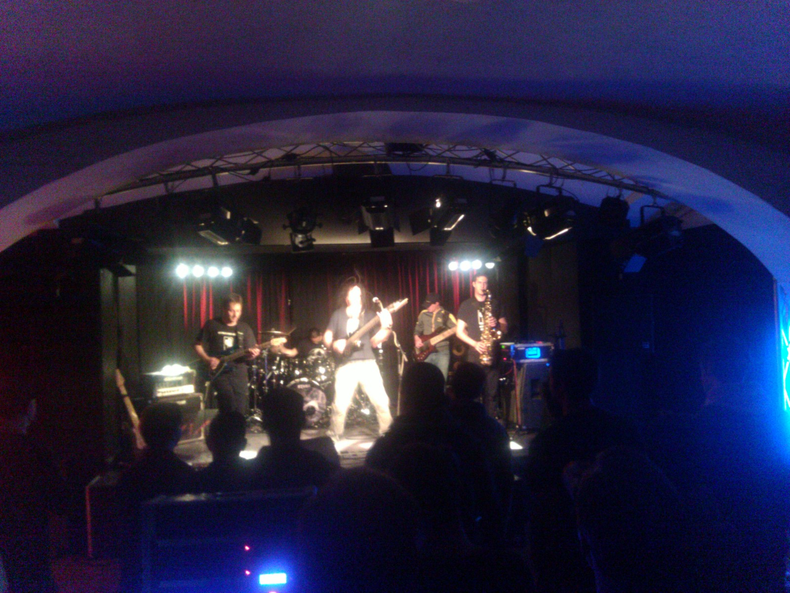

"Wellness-Death-Jazz" is printed in large letters across the T-shirts of some loyal fans who are head-banging right next to me. It is also what the guys on stage say their musical style is. Let me introduce to you: [Panzerballett](http://www.panzerballett.de).

Oddly enough the head-bangers are not the only distinct group that the audience is composed of. There are also those of us who are apparently enjoying the musical fireworks in a more introverted way and who start clapping after each solo, as etiquette dictates. Even without hearing the music, just by looking at the audience, you can tell that [Wikipedia](http://en.wikipedia.org/wiki/Panzerballett) is absolutely right by calling their music Jazz-Metal. But then of course you should hear their music!

<a class="yt-embed" href="https://www.youtube.com/watch?v=H7kDgnlU-u0" data-youtube="H7kDgnlU-u0" title="Panzerballett Live"></a>

Seemingly effortless they pump monstrous, rhythmically complex metal and jazz inspired themes, riffs and solos into the auditorium. What can I say: THEY ROCK! They've almost made me a heavy metal convert. And the best thing: they ask you to try this at home. From [the shop on their website](http://www.panzerballett.de/merch.html) you can get transcriptions (thanks Waschtl for pointing this out to me ;) ), T-Shirts and also their new album [CD Tank Goodness](http://www.amazon.de/dp/B008HC98SS).

I am glad they played at the [Kulturzentrum Hof](http://www.kulturzentrum-hof.at/) in Linz and that I had a chance to be at their concert. And of course I got myself a copy of their brand new album.

