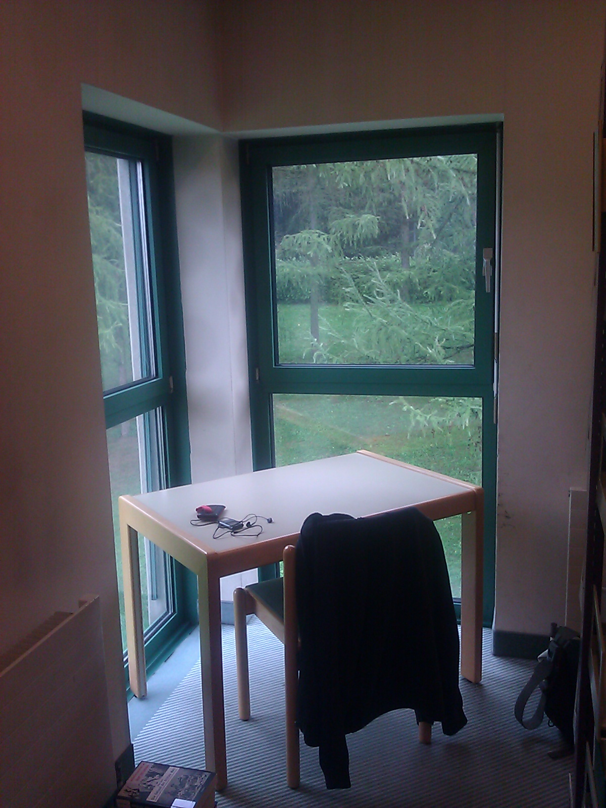
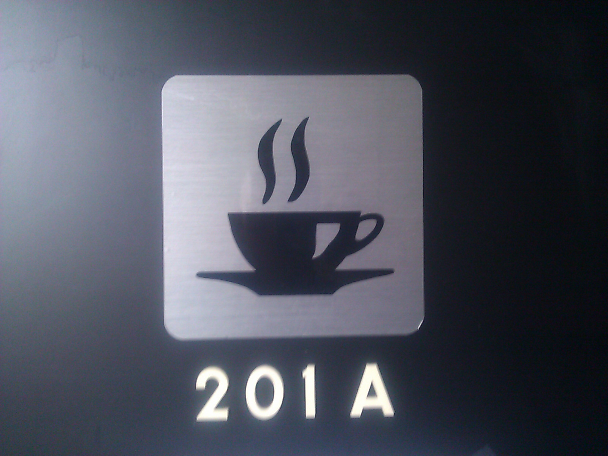
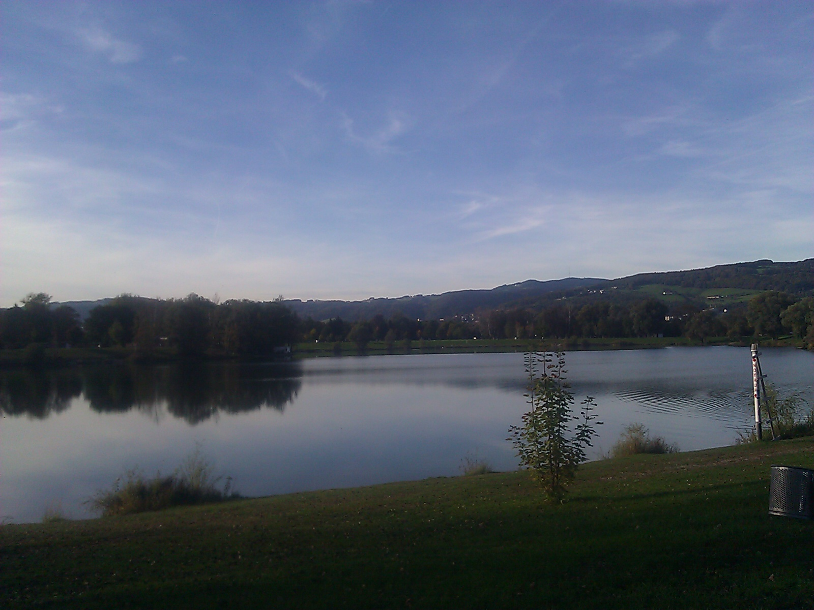

I recently blogged about [me wanting to escape the office for one hour every day](/blog/a-different-approach-for-30-days/). So here's an update of my progress.

Tuesday, 10/9/2012: That's when I wrote the [original blog article](/blog/a-different-approach-for-30-days/) about my 30-day-escape project, in some strange but nice niche at the university library.

Wednesday, 10/10/2012: Coffee with my sister! She's also a university assistant and PhD student here at [JKU](http://www.jku.at). Her office is within walking distance

Thursday, 10/11/2012: I spent with with preparations for the [beer tasting experiment](/blog/beertasting/).

Friday, 10/12/2012: Lunch with Manuela, a friend from Leoben who is also a [Pro Scientia](http://www.proscientia.at/) scholarship holder. - By the way Pro Scientia applications for 2012/2013 are still open!

Monday, 10/15/2012: [IEEE Student Branch](http://ewh.ieee.org/sb/austria/jkul/) Presentation with Andreas, Ernst and Robert for all first-year mechatronics and information electronics students. As always we showed John Cohn's great engineering paradise video and our own "I am IEEE" video.

<a class="yt-embed" href="https://www.youtube.com/watch?v=Y0DxmthvkKU" data-youtube="Y0DxmthvkKU" title="Engineering Paradise"></a>

<a class="yt-embed" href="https://www.youtube.com/watch?v=tq3DGIaAq5E" data-youtube="tq3DGIaAq5E" title="IEEE CEuSBC 2011, Linz, Austria - I am IEEE"></a>

Tuesday, 10/16/2012: [IEEE Student Branch](http://ewh.ieee.org/sb/austria/jkul/) Presentation again, now for all second-year mechatronics and information electronics students. Wednesday, 10/17/2012: Today [I went for a run (Click to see my track on Sports Trakcer)](http://www.sports-tracker.com/#/workout/chschmid/d4648iia090rmku0). I run regularly, but I don't even remember the last time when I ran before sunset. - Also the first time I've used the Science park showers that we are not supposed to use officially. Here's a nice autumn photo that I shot during my run.

