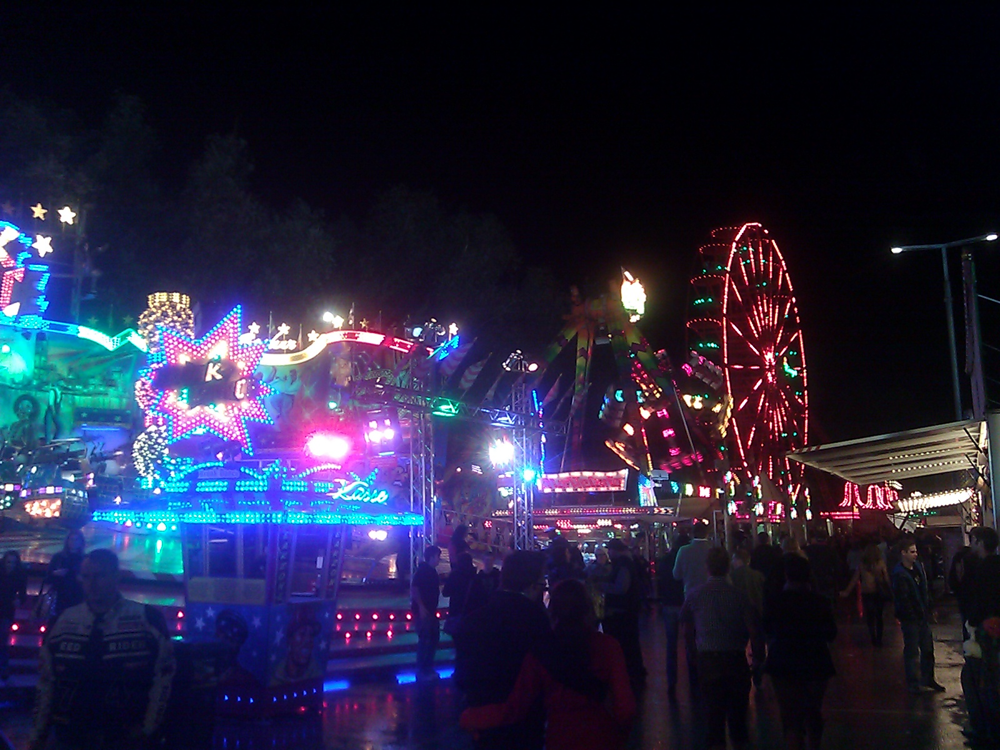
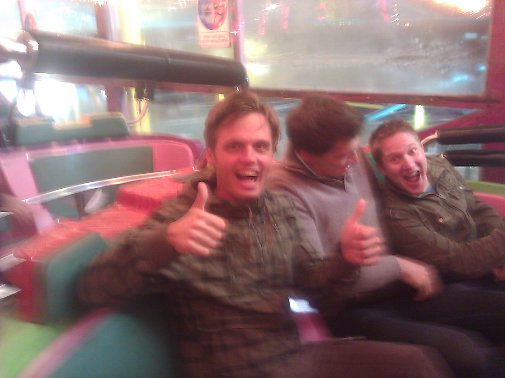
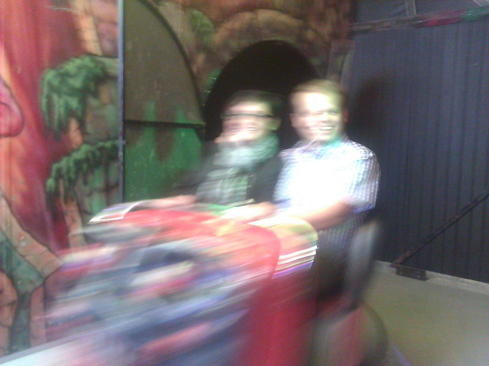
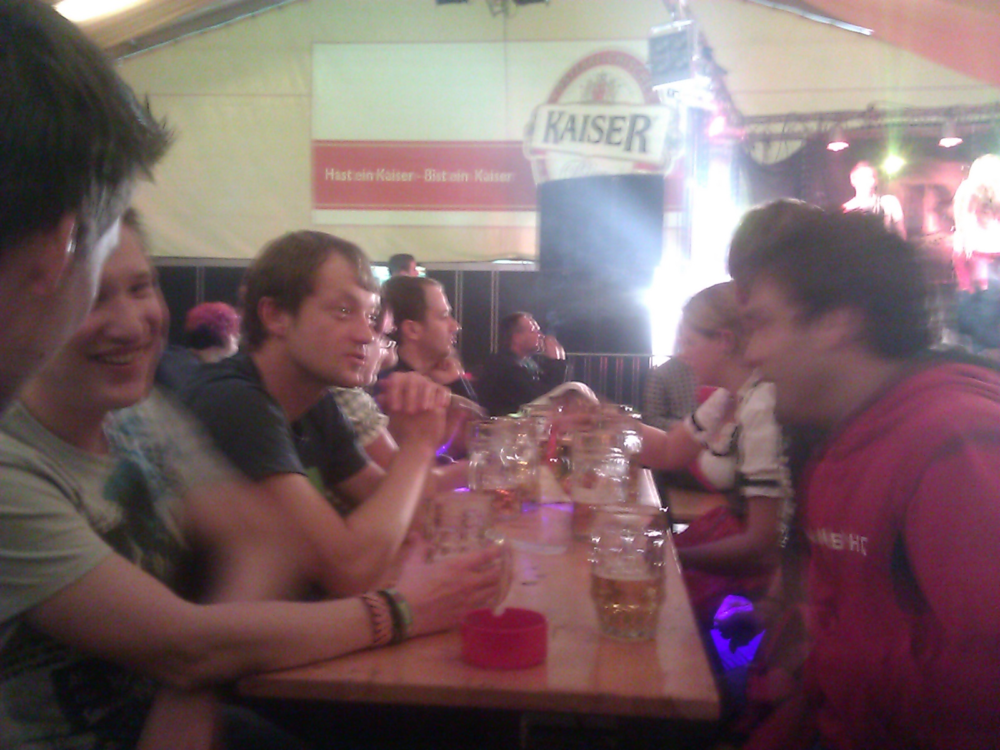
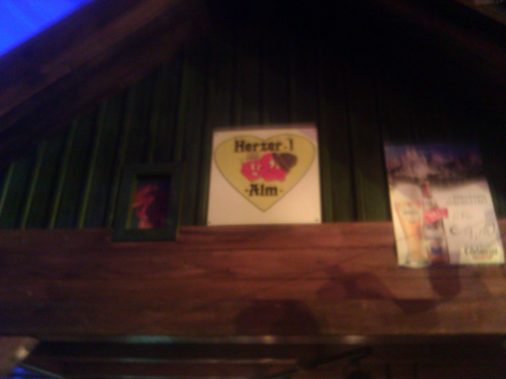
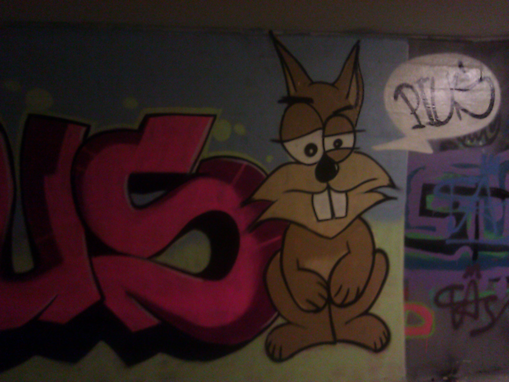

Way to much to do and too little time for blogging during the last week. So here's just a quick update on Thursday night, which I spent at the [Urfahraner Jahrmarkt](http://de.wikipedia.org/wiki/Urfahraner_Markt) with some college mates. For those of you who don't know the [Urfahraner Jahrmarkt](http://de.wikipedia.org/wiki/Urfahraner_Markt), think of it as a small [Oktoberfest](http://en.wikipedia.org/wiki/Oktoberfest), a fair with lots of amusement rides, foods, drinks ...

 

After some rides, including the obligatory ghost train

we ended up in one of the beer halls.

It was great to see my college mates again and to hear their stories about what they have done since graduation. Hannes for instance told me about the 8000 Liter/Minute water pump that he just finished designing, which is going to be used by fire fighters. After a final location switch to the Herza'l Alm, which if you translate it literally means "alp of hearts",

I went home, partly using the same way that I had to use on a daily basis to get from the dorm to the university during my time as an undergraduate student. Good to see that all the graffiti on the way are still subject to change!

