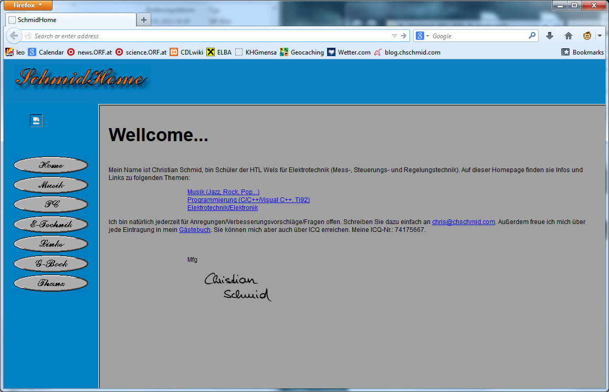
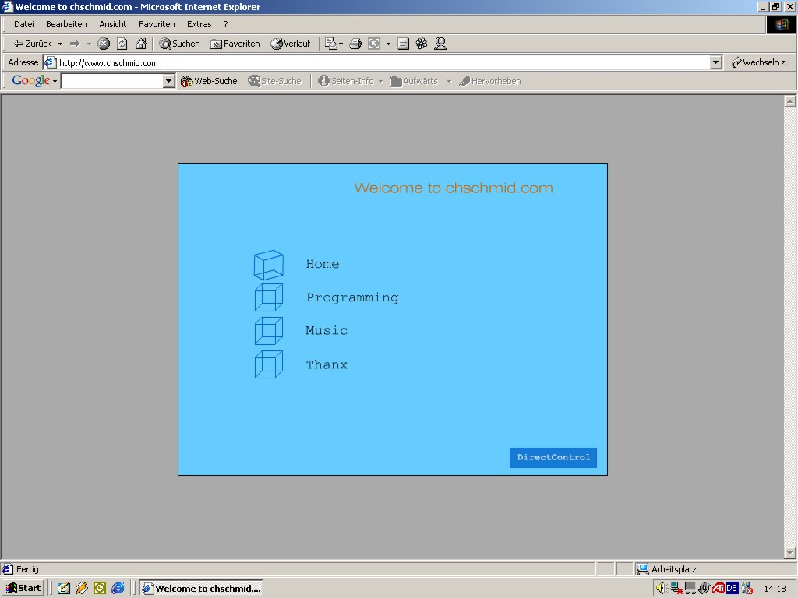
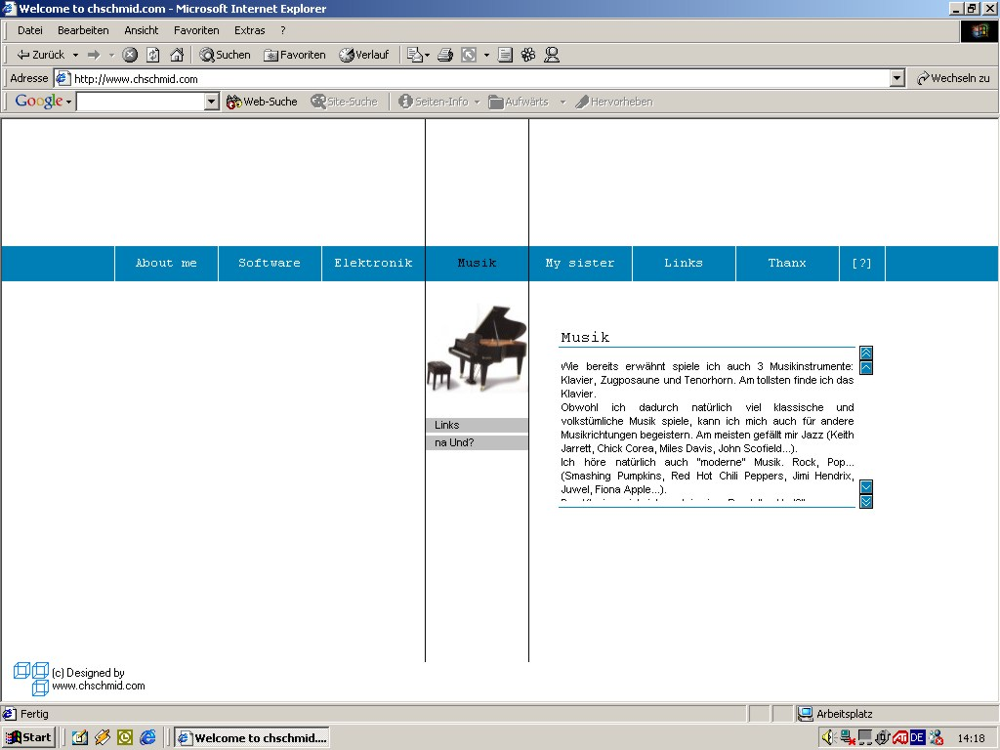
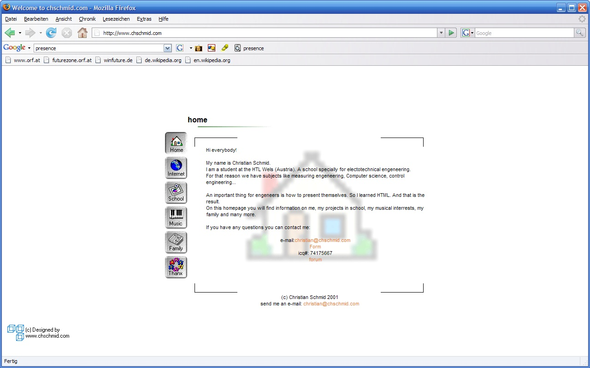
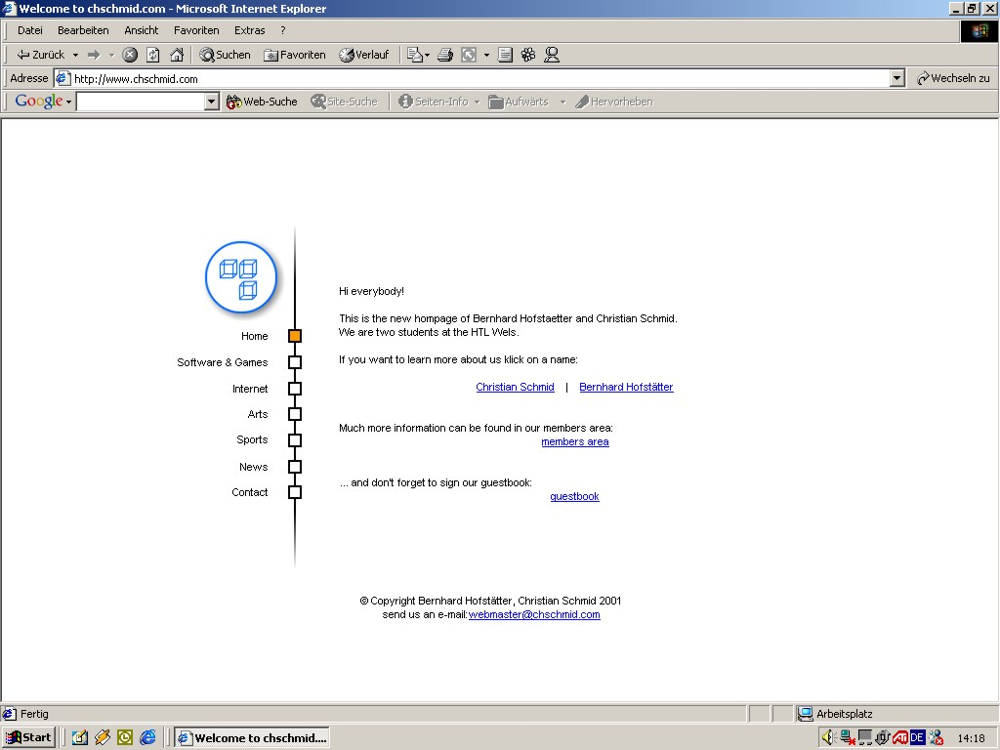
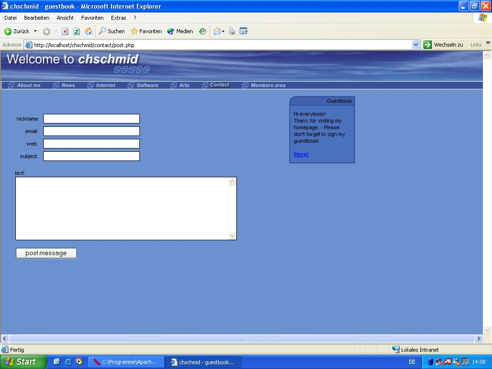
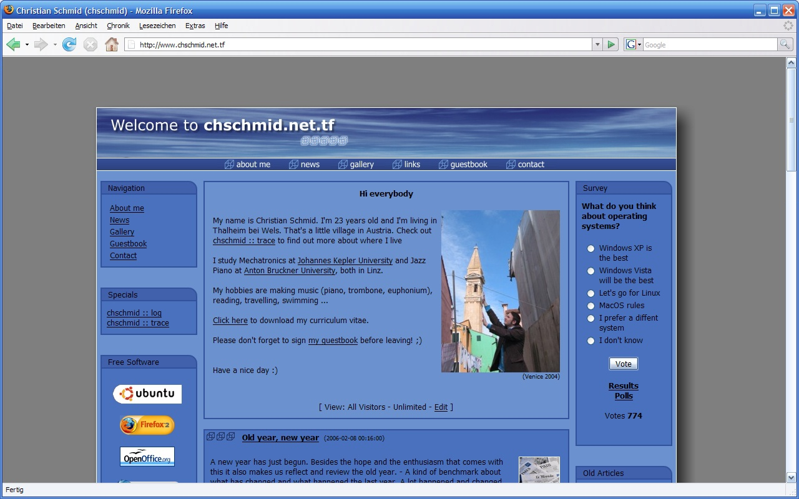
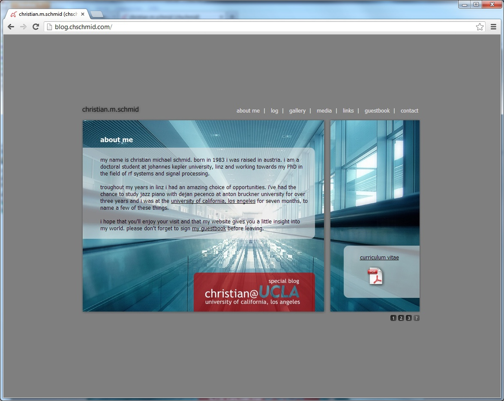
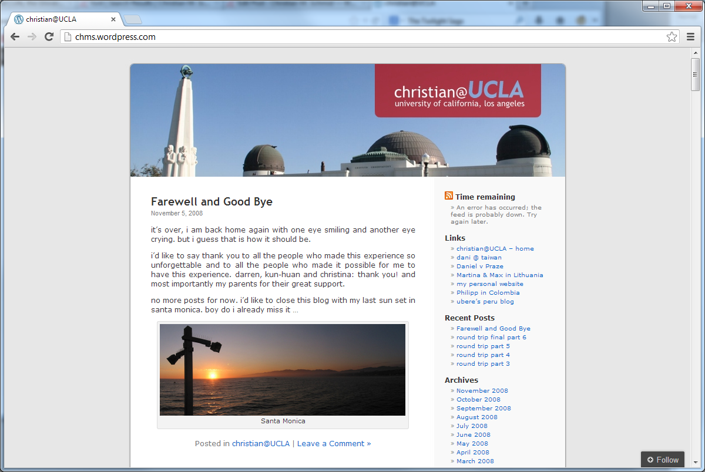
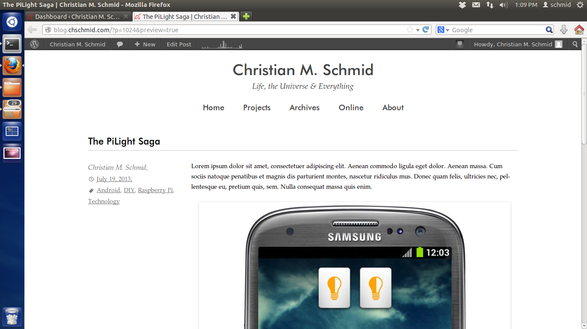

From time to time I just can't resist: My website / blog (whatever it is) has to change. The time has come again and the result is what you are looking at right now. This recent facelift triggered me to dig through my personal archives and old back-ups to take a look at the long way my website(s) has / have come. And truly a long way it is.

## 1999 - My First Lines of HTML

I found out that I wrote my first couple of HTML and JavaScript lines in 1999, a time when everybody was still using [Netscape Navigator](http://en.wikipedia.org/wiki/Netscape_Navigator) to browse the web and [Altavista](http://en.wikipedia.org/wiki/AltaVista) to google - obviously nobody called it "to google" at the time. I had no idea how to use computer graphics software, but paintbrush and my 56k modem - yep one of those that made the funny noises - was all I needed to upload my first piece of HTML art.

Well, lots of typos and not exactly art. Fun fact: I used Labview to generate the buttons. By the way this is the only thing that I've ever found Labview to be useful for.

## 2000 - Flash and HTML

The next thing I discovered was a soon-to-be-dead technology known as Flash, which I used to create Version 2.0 of my personal website in 2000.

Please note the cubes, which would stick with me for a couple of years. I did also get my own domain www.chschmid.com around that time. It was a free offer, all you had to accept was ads on your website, which I of course was able to hide via JavaScript. As not every computer supported Flash I also continued with HTML in parallel. The interesting aspect about HTML based websites is that you can always look at the source code. So what I did is I just copy-and-pasted an interesting design that I had found online and modified it to my needs. Yes this is stealing, but I just did not care at the time.

Until the time came that I did care and so I designed a new website in 2001.

## 2001 - HTML Design

This actually was the first time that I did really design something in HTML. I had learned how to use the Corel Graphics Suite by then and the design was centered around icons and styles that remind me very much of the icon design language of the 90s.

In the same year I did try to set up a website as joint project with a very good friend of mine. He's doing [a lot of photography](http://500px.com/bhofstaetter "Bernhard Hofstätter") these days.

## 2001/2002 - The Rise of PHP

In 2001/2002 I started using PHP and MySQL as server-side technologies to enhance my website. All of my PHP scripts were home-grown and for applications such as guestbooks and calendars. At the same time I also started to work for [Fronius](http://www.fronius.com/) as web developer. Looking back it is funny to see how little I knew, and how much that was worth at a time, when it was common knowledge that the Internet is THE big thing yet virtually none of the 35+ knew much about the technologies behind it. So here's my design from 2001/2002.

There are some note-worthy aspects about this screenshot. First it shows that I ran Windows XP, second I was using IE (Ah!!!), third and most importantly: From the URL and the taskbar one can see that I had Apache running on my local machine for developing PHP scripts.

## 2002-2006 - PHP Nuke

In 2002 I found out that there were online communities that developed PHP Content Management Systems. Looking back I made a very bad choice and started using [php-nuke](http://en.wikipedia.org/wiki/PHP-Nuke). I did also code some modules for the system.

I think some time in 2003 the free domain offer expired, and I began using www.chschmid.net.tf instead of www.chschmid.com. From then on I was also forced to be aware of CSS, which I had tried to avoid whenever possible. Interestingly this had worked quite well for a long time! In 2006 I did a minor facelift to account for the facts that screen resolutions were getting higher and that font rendering and anti-aliasing technologies had advanced. At the same time php-nuke had some serious security vulnerabilities and I found that the framework was more than I actually needed.

## 2006-2008 - HTML + PHP

So I did another redesign, again with almost static HTML and some home-brewed PHP + I did improve the design to be more photo-centric in 2007.

I didn't change content regularly but uploaded all my music gigs.

## 2008+ - Wordpress

When I went to UCLA in 2008 I needed a more flexible system for pushing information online regularly. With lots of exams and the bureaucracy of going to the US at hand I didn't have too much time to set up the whole thing, so I went with a blog hosted at wordpress.com and minor default template modifications: [chms.wordpress.com](http://chms.wordpress.com).

I did get back "my domain" in 2009 and set up a self-hosted wordpress blog in 2010. I again used a pre-defined wordpress template with some individual modifications. Actually I did come to the decision that I wanted a new blog while on a plane from Hawaii to LA and set the whole thing up during my [first night in LA](/blog/hello-world/). - You gotta fight jet lag somehow, right. In 2012 I did read and play around a lot with fonts, and so some font changes became inevitable.

What is interesting to see in all screenshots from 2006-2013 is that fonts have become more important, more beautiful and that there were a lot of pseudo-realistic design elements: Textures, shadows, lots of boxes - something that more and more designers are avoiding these days, e.g., if you think about the iOS 7 resign, or the bold and beautiful move that Microsoft has made with Windows Phone 7 and Windows 8 a few years back.

## 2013 - The Time is Now

This brings me to what you have in front of you today: A novel, minimalistic, content-centered approach. It's a new theme for the same self-hosted wordpress system, that I have been using since 2010 (with all the latest updates of course)

And so here come the most important questions: What do you think about it? What would you change? And maybe: What's your personal Web story? PS. My template can of course be downloaded from [my github site](https://github.com/chms/cS-Twenty-Thirteen).
