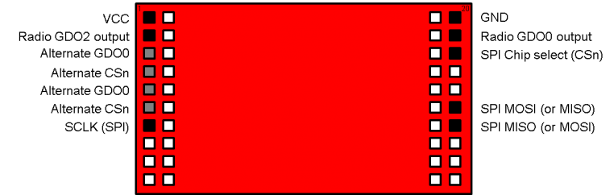
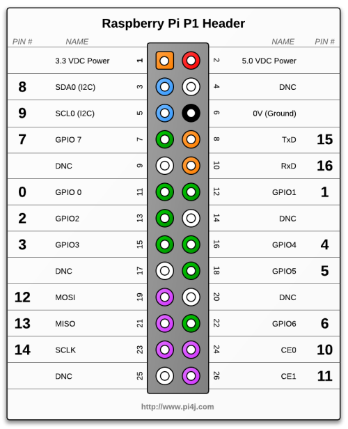
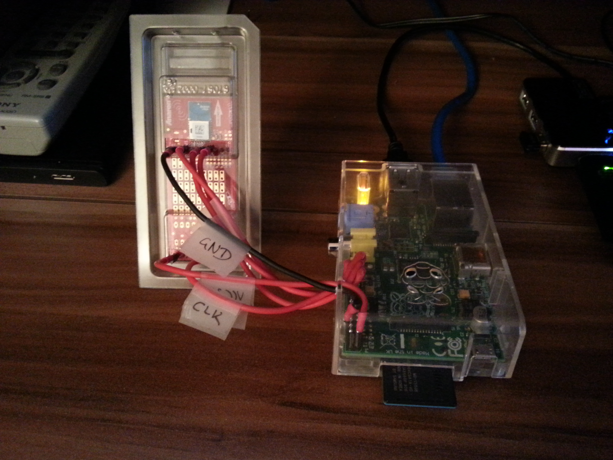

My Raspberry Pi lets me and everybody else control my bedroom light from virtually anywhere in the world. But lets start with a video on what everybody can do with pilight.

<div class="video"><a class="yt-embed" href="https://www.youtube.com/watch?v=SDPua5HbuGw" data-youtube="SDPua5HbuGw" title="PIMORSE"><span class="yt-play"></span></a></div>

## Table of Contents

[1\. Introduction](#1-introduction)  
    [1.1 The Story Behind This Project](#11-the-story-behind-the-project)  
    [1.2 The Hardware](#12-the-hardware)  
    [1.3 A Schematic Block Diagram](#13-schematic-block-diagram)  
[2\. PI <-> 868 MHz](#2-pi---868-mhz)  
    [2.1 The Physical Connection](#21-the-physical-connection)  
    [2.2 The SPI Commands](#22-the-spi-commands)  
    [2.3 PI Prerequisites](#23-pi--prerequisites)  
    [2.4 Programming the PI](#24-programming-the-pi)  
[3\. pilight: WiFi <-> PI](#3-pilight-wifi---pi)  
    [3.1 The Android Widget](#31-the-android-widget)  
[4\. pimorse: Web <-> PI](#4-pimorse-web---pi)  
[5\. Source Code and Installation](#5-source-code-and-installation)  
[6\. Summary](#6-summary)

## 1\. Introduction

### 1.1 The Story Behind the Project

I installed a dimmer switch in my bedroom a couple of years ago, which can be controlled via a remote control that operates in the 868 MHz band. Also a couple of years ago [I reverse engineered the protocol and implemented it on my TI Chronos watch](/blog/ti-chronos/ "chronos.chschmid.com").

In this little weekend project I hooked up a [Raspberry Pi (RPi)](http://www.raspberrypi.org/) with a [CC110L RF BoosterPack](http://www.ti.com/ww/en/RF-BoosterPack/ind) via [SPI](http://en.wikipedia.org/wiki/Serial_Peripheral_Interface_Bus). With the RPi being connected to a WiFi router and to the world wide web via a server this lets me and everybody else control my bedroom light from virtually anywhere.

What I do like most about this project is that it covers so many layers of abstraction: From rather high level Android programming, a WordPress template (CSS, PHP, reCAPTCHA), to PHP scripts on my [LAMP](http://en.wikipedia.org/wiki/LAMP_%28software_bundle%29) server, to a “proprietary” TCP/IP socket connection + code on a RPi, to actual SPI voltage signals on 4 wires, to register settings and a 64 byte FIFO in a low-level RF transceiver and finally to 868 MHz signals.

### 1.2 The Hardware

This project combines

-   an Android device (for toggling) or any device that can browse the web (for sending Morse code via my bedroom light)
-   a router / switch
-   a [LAMP](http://en.wikipedia.org/wiki/LAMP_%28software_bundle%29) server
-   a Raspberry Pi ([http://www.raspberrypi.org/](http://www.raspberrypi.org/))
-   a CC110L RF Booster Pack ([http://www.ti.com/tool/430boost-cc110l](http://www.ti.com/tool/430boost-cc110l))
-   and a dimmer from Conrad Electronics ([http://www.conrad.at/ce/de/product/620587/Funk-Lichtschalter-mit-Sender](http://www.conrad.at/ce/de/product/620587/Funk-Lichtschalter-mit-Sender)).

### 1.3. Schematic Block Diagram

Here’s a video explaining the basic building blocks of my system:

<div class="video"><a class="yt-embed" href="https://www.youtube.com/watch?v=fHQjS5Kg6cw" data-youtube="fHQjS5Kg6cw" title="PiLight"><span class="yt-play"></span></a></div>

As in the video, let’s take a look at the whole thing bottom-up.

## 2\. PI <-> 868 MHz

The [CC110L RF Booster Pack](http://www.ti.com/tool/430boost-cc110l) has to be talked to via an interface called [Serial Peripheral Interface (SPI)](http://en.wikipedia.org/wiki/Serial_Peripheral_Interface). My guess is that there are almost no computers where there is no SPI interface at least somewhere. Still SPI interfaces are usually not read/write-able from applications, as they are just too “low-level”. The RPi is different. It has SPI-pins + there is a kernel module to use those pins from an application.

### 2.1 The Physical Connection

To get started one has to connect the VCC, GND, MISO, MOSI, CLK, and CS pins of the RPi and the RF Booster Pack. Here’s the pin layout of both.

 

Make sure you connect

VCC <-> 3.3 VDC Power  
GND <-> 0V (GND)  
SCLK (SPI) <-> SCLK  
SPI MOSI <-> TxD  
SPI MISO <-> RxD  
CSn <-> CE0

This is what it looks like in my case:



### 2.2 The SPI Commands

After you’ve established the physical connection you have to figure out what to SPI commands to send. The key here are [TI’s RF studio](http://www.ti.com/tool/smartrftm-studio) and the [CC110L datasheet](http://www.ti.com/product/cc110L). This is non-trivial, but in the end you’ll figure out what commands you’ll have to send via SPI to produce [the same 868 MHz signals that the remote would produce](/blog/ti-chronos/ "chronos.chschmid.com"). (By the way this was the most time-consuming part of the project)

### 2.3 PI  Prerequisites

Ok now that the physical connection is established and now that you know what to send it’s time to let the PI actually do it. My RPi runs on [Raspbian](http://www.raspbian.org/), so some of the things might be different for you if you use another Linux distribution. Here’s what you’ll need to do on a Raspbian system.

1.  First of all you’ll need to load the required kernel module on start-up by adding the line “spi-bcm2708” to your /etc/modules file. After adding this line you can either reboot or load the module manually via “sudo modprobe spi-bcm2708”.
2.  By default only the root user is allowed to use the SPI interface. It really depends on which user you want to run the server. If you run it as super user (= not recommended) your done already. But if you want to run it as your standard user create a file “/etc/udev/rules.d/50-spi.rules” with the following content SUBSYSTEM==”spidev”, GROUP=”spi” and [add your standard user to the group SPI](http://lmgtfy.com/?q=linux+manage+users+and+groups). Again reboot or [restart your udev deamon](http://lmgtfy.com/?q=restart+udev).
3.  This is not SPI specific, but as the server is written in Java you’ll need to install a [Java Runtime environment](http://en.wikipedia.org/wiki/Java_Runtime_Environment#Execution_environment). E.g., via “sudo apt-get install openjdk-7-jre”

To check if everything works properly after you rebooted your machine, run “ls -al /dev/ | grep spi” which should give you something like

```bash
crw-rw---T  1 root spi     153,   0 Aug 18 00:31 spidev0.0
crw-rw---T  1 root spi     153,   1 Aug 18 00:31 spidev0.1
```

and ” java -version” should show something like

```bash
java version "1.7.0_07"
OpenJDK Runtime Environment (IcedTea7 2.3.2) (7u7-2.3.2a-1+rpi1)
OpenJDK Zero VM (build 22.0-b10, mixed mode)
```

### 2.4 Programming the PI

The program to run on the PI has to be able to write to the SPI and to listen to a TCP/IP port for incoming messages, which is something you can do in practically any programming language. With my limited programming experience it basically comes down to a choice of C/C++, Matlab, Java and Matlab. I decided to go with Java. I used the [PI4J library](http://pi4j.com/) to do the SPI stuff and the [netty.io library](http://netty.io/) for the networking stuff.

## 3\. pilight: WiFi <-> PI

OK, I’ve already spoiled everything, I used Java and the [netty.io libary](http://netty.io/) to listen to commands from the network. – And I connected the PI to a router, which I configured so that it assigns a static local IP to the PI.

The java program I wrote actually creates two servers. One for commands to turn the lights on / off and for dimming the light (port 22041), and another one for processing morse codes (port 22042). Port 22041 is used from my Android app, and Port 22042 is used for everyone from the WWW.

### 3.1 The Android Widget

The server on the PI listening to port 22041 is for direct on/off/dimming commands. I wrote a simple Android widget that connects to this port and sends the required commands. As the widget tries to connect to the local address (which is fixed in the router settings) the Android widget only works when the device is connected to my home network. (Of course tunnelling via SSH is always an option ;)

## 4\. pimorse: Web <-> PI

My router is configured to route traffic from the web through ports 22, 80 and 443 to an x86 server on my network. I just did not want to expose the PI to the web directly.

The server is an x86 machine running Ubuntu 12.04 and the full [LAMP](http://en.wikipedia.org/wiki/LAMP_%28software_bundle%29) experience. I wrote a PHP script for it that translates plain text to morse-code which is then forwarded to the PI on the local network, port 22042.

Give it a try at [http://pimorse.chschmid.com/](http://pimorse.chschmid.com/) to send your personal message out into the world via Morse code.

## 5\. Source Code and Installation

The source code is available on [github/chms/pilight](https://github.com/chms/pilight). Basically there are three components

-   pilight-server: The java software running on the PI;
-   pilight-android-client: The Android client;
-   pimorse: PHP scripts for your Webserver.

All components come with a readme file that details how the components can be installed. pilight-server comes with an installer script.

## 6\. Summary

Again one of my favorite aspects about this project is that it involves so many different levels, and was still doable in a couple of days.

However apart from the personal joy that it gave me, it also got me thinking: If this is doable for me in less than 100 hours, why don’t we have the Internet of Things (IoT) already? I really don’t know. What I do know is that there are a few inherent security flaws in my system that are probably present in practically all of today’s sensor networks. E.g. anyone who knows the 868 MHz code of my remote, could simply walk up to my apartment and start toggling my bedroom light.

For all that I know it looks like the power requirements that we have on the IoT require serious trade-offs, which probably quite often effect robustness and security. Just two examples: in a presentation that I heard last week it was mentioned that [Contiki](http://en.wikipedia.org/wiki/Contiki), the most prominent OS for IoT applications, does not support rings and works with cooperative multi-tasking.

I am really not an expert, but the solution to the IoT seems non-trivial. I am curious, suspicious and excited what will come next and I hope so are you!

Please let me know what you think about this project and don’t forget to have a little fun with your RPi as well! After all that’s what it was made for!
