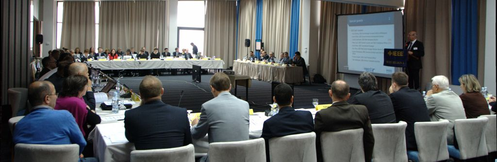

about 1400 km of travel, 3 days, more than 100 IEEE people from over 60 countries, but less than 15 hours of sleep.

I won't tell you about that short city visit. Most of what has happened this weekend has actually happened at a place called the Sarajevo Hollywood Hotel, where we (the more than 100 IEEE people) and at least five times as many Wrestlers mingled ([http://www.worldveteranwrestling-sarajevo2013.com](http://www.worldveteranwrestling-sarajevo2013.com)). - Not that we were there for the same reason.

It was the second IEEE Region 8 committee meeting for me and I feel it was even more intense than my first one in Madrid in April. While IEEE is an engineering association, the truth is, these meetings are mostly political - politics about coming up with solutions and policies to "[foster technological innovation and excellence for the benefit of humanity](http://www.ieee.org/about/vision_mission.html)". Apart from the matters at hand, these meetings are great opportunities to witness different styles of leadership, different styles of communicating with each other and different approaches to problem solving in general. The best part is you can actively participate if you don't mind throwing around, being thrown around and having your head go all wild with thinking.

Here are some notes I made to myself about the process rather than the outcomes during the meeting:

1.  With most of us being engineers in academia, we are having a huge problem thinking outside the box.
2.  Almost everything you propose, someone will have proposed at some point already. (Maybe this is a direct consequence of 1.)
3.  Although it may lead to wasting your and other people's time, it is still worth proposing stuff, even if this results in wiser and more experienced people stopping you right away. Otherwise you risk missing the few jewels that might be hidden somewhere in people's heads!
4.  You would probably need at least as much time for preparations (in terms of goals, strategy, background research) as the meeting takes, to make the most out of it.
5.  Not having a clear vision on certain issues (maybe due to a lack of 4.) will make you feel like bouncing between people's opinions. - Which, then again, might not be that bad after all for getting an idea about things.
6.  If it comes down to making a decision, following 5 think about Alice in Wonderland's Cheshire cat. Alice: "Which way ought I go from here?" Cat: "That depends a good deal on where you want to get to?" Alice: "I don't much care where--" Cat: "Then it doesn't matter which way you go"
7.  You were quite slow in understanding what people really meant. "Sorry for that."
8.  If you are working on one-size-fits-all-solutions (which many things on a Regional level are) be careful when you start statements with things like "From my experience ...". While difficult to implement: You really ought to make decisions based on statistical and scientific analysis rather than on very limited personal experiences.
9.  Even if it gets rough sometimes, don't forget to grab a beer with people at the end of the day and thank them for their contributions. Be respectful: You need them as much as they need you.

I guess I succeeded and failed at all of them and I am not sure if these notes will help me or you in any way. Still I thought I'll write them down, just in case I want to revisit them before the next meeting ...
