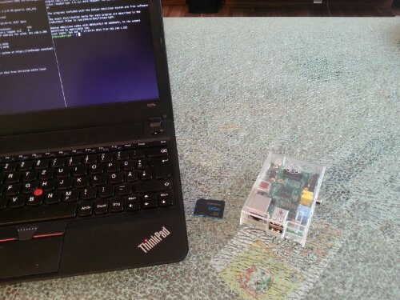

Sorry to disappoint some of you: This is not about the great movie that I watched on an airplane on my way to Seattle just recently. This post is about my newest gadget. I just could not resist getting myself a [Raspberry Pi](http://en.wikipedia.org/wiki/Raspberry_Pi), which is a low power (low power as in low electrical power but also as in low computational power) credit-card-sized single-board ARM computer. Meet my new toy:

I did also buy

-   a transparent case,
-   an 8GB SD card,
-   and a micro USB charger as power supply.

If you order all of this stuff online you should be able to get it for around 50-60 €. - When it comes to the Raspberry Pi (RPi) low power also means inexpensive. What I did not expect: I had it up and running in about 10-15 minutes. [Raspbian](http://www.raspbian.org/) was the obvious choice for me as [Ubuntu](http://www.ubuntu.com/) user. After

1.  downloading the Raspbian image from [http://www.raspberrypi.org/downloads](http://www.raspberrypi.org/downloads)
2.  extracting it via the terminal unzip 2013-05-25-wheezy-raspbian.zip
3.  copying it to the SD card via the terminal sudo dd bs=4M if=2013-05-25-wheezy-raspbian.img of=/dev/mmcblk0 && sudo sync
4.  plugging the SD card into the RPi and connecting the power supply / monitor / keyboard,

I could configure the RPi using the built in Raspbian tool. Again, 10-15 minutes + maybe 10 extra minutes for the first time configuration, absolutely hassle-free, and you'll be greeted by the familiar Linux login. - I was impressed. Now the obvious question that most people are likely to ask is: "What are you going to do with it" and I am guilty as charged. More often than not I do buy those gadgets without even knowing what I would need or use them for, just for the fun of playing around with them. With the RPi it's quite similar tough I have two applications in mind, with one of them up and running already:

1.  RPi as music streaming device
2.  RPi as "bedroom light server"

2\. will be a more elaborate project, which I am going to talk about some other day, 1. is more obvious. The thing is I am running a home server (Ubuntu 12.04 on some low power AMD E-350 hardware) which (amongst others) acts as Logitech Media Server for a [Logitech Squeezbox Radio](http://en.wikipedia.org/wiki/Squeezebox_%28network_music_player%29) and a [Logitech Squeezebox Touch](http://en.wikipedia.org/wiki/Squeezebox_%28network_music_player%29). I do really love both devices and the whole Squeezebox concept. It lets you stream music from a local server as well as from Internet radio stations, synchronize multiple players, control everything via PCs / smartphones / tablets and much more.

Both pieces of hardware that I did get from Logitech were not cheap, but are worth every penny (or Euro cent in my case). Moreover all software, both the server and the client side, is cross-platform and open-source. This is probably mainly due to the fact that Squeezebox was not invented by Logitech but by Slimdevices which was later acquired by Logitech. Anyway, Logitech managed to ruin one of the most promising competitors in the audio streaming market and in 2012 announced that they would discontinue the Squeezebox line in favor of a new, over-priced and crappy product line with less features. No worries, I will stop complaining about Logitech's completely crackbrained decision, because there is a solution: The RPi can stand in as perfect Squeezebox streaming device replacement!

In a later post I am going to explain how to configure the whole thing to run when the RPi starts up. For now (again from a terminal) it is just as easy as

-   wget https://squeezeslave.googlecode.com/files/squeezeslave-1.3-390-armhf-lnx32.tar.gz
-   tar -zxvf squeezeslave-1.3-390-armhf-lnx32.tar.gz
-   ./squeezeslave -o 0 -M "test.log" 192.168.1.200

That's all that is needed to turn your RPi into a Squeezebox client in under 30 minutes and the beginning of the life of my new Raspberry Pi ...
