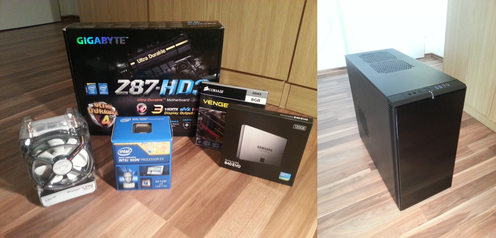

[The hardware](/blog/the-making-of-me-chschmid-com-part-2-the-hardware/ "The Making of me.chschmid.com, Part 2: The Hardware") arrived! Two hours of applied screwdriver science led to this before and after photo.

What was new to me, because I had never done it before, was to mount a CPU into a motherboard socket. I guess I've done it right because the machine boots as it should.

Next stop: An operating system.
