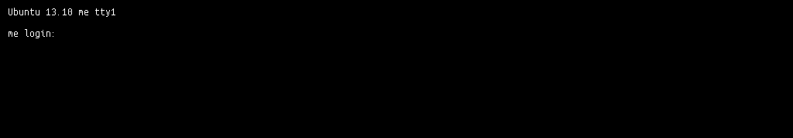

[With all components where they should be](/blog/the-making-of-me-chschmid-com-part-3-mechanical-assembly/ "The Making of me.chschmid.com, Part 3: Mechanical Assembly") and the machine booting, installing an operating system (OS) was the next step. [GNU/Linux](http://en.wikipedia.org/wiki/Linux) was the obvious choice and all of my machines run on [Ubuntu](http://en.wikipedia.org/wiki/Ubuntu_%28operating_system%29), so Ubuntu it is.

As the machine is intended to act as server, Ubuntu 12.04LTS would make sense, however as my Xeon Haswell CPU (E3-V1245V3) is relatively new, the Linux Kernel and drivers that come with 12.04 are not a perfect fit for the hardware. - So Ubuntu 13.10 it is.

It was as simple as this: Download the 13.10 server image from [http://www.ubuntu.com/](http://www.ubuntu.com/), put it on an USB drive using [http://www.pendrivelinux.com/](http://www.pendrivelinux.com/) (Windows) or the [Startup Disk Creator](http://www.ubuntu.com/download/desktop/create-a-usb-stick-on-ubuntu) (Linux). Restart the machine, enter the boot menu by pressing F12 and boot from the USB drive. The setup is quit intuitive. As I started with an empty SSD, all I had to do is select automatic installation using LVM on the empty hard drive. To start with I selected LAMP, OpenSSH and Samba as server roles.

The computer rebooted after the installation leaving me with a login prompt.



After login I installed all the stuff that I would need to also run the PC as desktop.

```

sudo apt-get update
sudo apt-get dist-upgrade
sudo apt-get install ubuntu-desktop vlc vainfo lm-sensors calibre texlive-full ipe audacity p7zip thunderbird eclipse wine git-core keepass2 gparted filezilla inkscape chromium-browser kile qjackctl virtualbox virtualbox-guest-additions-iso pavucontrol pulseaudio-module-jack joe rosegarden xdotool musescore dconf-tools openjdk-7-jdk libva-intel-vaapi-driver ufw gufw nautilus-open-terminal smartmontools gksu gimp build-essential devscripts debhelper javahelper
```

Finally reboot the machine and you should be greeted by a graphical user interface.

```
sudo shutdown -r now
```
