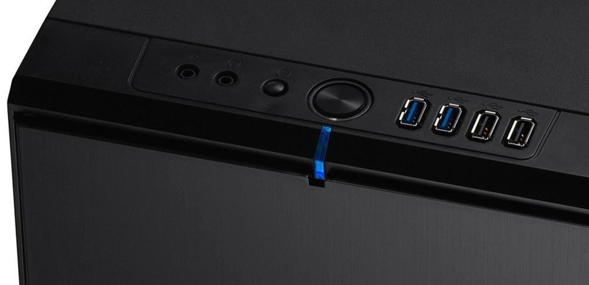

[With the base OS up and running](/blog/the-making-of-me-chschmid-com-part-4-the-operating-system/ "The Making of me.chschmid.com, Part 4: The Operating System") it's time to install and configure all the services. By the way it is important that the server is not connected to the Internet directly yet. - Working behind a router is ok. You just don't want that out your server can be accessed via the web already.



## SSH

SSH is a secure way of accessing your machine from anywhere. You can transfer files, run commands, tunnel services and probably much more using SSH in an easy and encrypted way. After the server installation SSH is running already. But I did some modifications to the config file "/etc/ssh/sshd\_config" to make it even more secure. Basically I added one line

```
AllowUsers christian cs-git
```

to only allow incoming connections for those two users. Restarting the ssh daemon can be done via

```
sudo service ssh restart
```

## Apache

I don't want my machine to be accessible via HTTP, but only through the more secure HTTPS. So I configured [port 80 to redirect to 443](http://wiki.apache.org/httpd/RedirectSSL) and [enabled https](http://www.unixmen.com/install-apache-ssl-ubuntu-13-10/). I also added the following lines to my https config file

```
SSLProtocol all -SSLv2 -SSLv3
SSLHonorCipherOrder On
SSLCipherSuite
ECDH+AESGCM:DH+AESGCM:ECDH+AES256:DH+AES256:ECDH+AES128:DH+AES:ECDH+3DES:DH+3DES:RSA+AES:RSA+3DES:!ADH:!AECDH:!MD5:!DSS
SSLCompression Off
```

to make the encryption more robust. - You can check how robust your encryption is via [https://sslcheck.globalsign.com](https://sslcheck.globalsign.com).The apache server can be restarted again via

```
sudo service apache2 restart
```

## Owncloud

... can be installed easily via an opensuse repository at [http://software.opensuse.org/download/package?project=isv:ownCloud:community&package=owncloud](http://software.opensuse.org/download/package?project=isv:ownCloud:community&package=owncloud). The configuration works via the web interface [https://localhost/owncloud](https://localhost/owncloud). In my case I just transfered the complete database from my old machine to the new server.

## Samba Server

The Samba Server is used to share files locally, so that I can download the music files stored on the server from my tablet whenever I am in my local network and stuff. - Again Samba should be installed already and only needs to be configured. I added

```
[media]
    comment = Media
    path = /home/media
    browsable = yes
    guest ok = yes
    writeable = no
    write list = media
    force group = media
    create mask = 0775
```

to my "/etc/samba/smb.conf" to share what is in the /home/media folder and allowed following symlinks

```
follow symlinks = yes
```

I forgot of course I also created a user media using "sudo adduser media". I again restarted smbd and nbmd

```
sudo service smbd restart
sudo service nmbd restart
```

## Squeezebox Server

I use this system to stream my audio across multiple devices ([including my Raspberry Pi](/blog/raspberry-pi-raspbian-squeezeslave-my-new-squeezebox/ "Raspberry PI + Raspbian + Squeezeslave")). To install the server run

```
sudo add-apt-repository "deb http://debian.slimdevices.com stable main"
sudo apt-get update
sudo apt-get install logitechmediaserver
```

## Misc

I also installed and configured the following things

-   A vncserver (x11vnc)
-   The Plex Media Server (can be found in Ubuntu's repositories)

Im glad you made it to the end of this rather boring post, but that is what servers are all about: Running boring stuff in the background that makes our lives easier and more connected.
