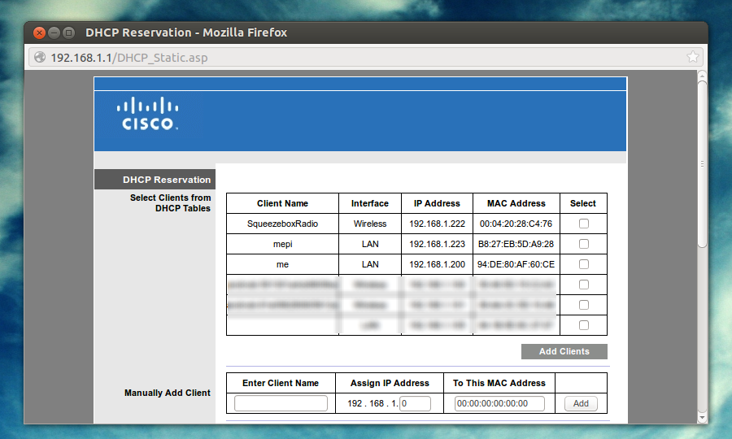
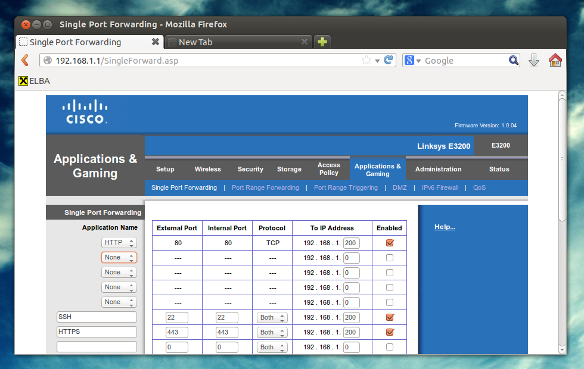

So far [the server](/blog/the-making-of-me-chschmid-com-part-5-server-configuration/ "The Making of me.chschmid.com, Part 5: Server Configuration") was in a protected environment, but it's time to let it see the world! This involves three things:

-   Setting up the server firewall
-   Configuring the dyndns stuff
-   Setting up the router

## Server Firewall

You only want those ports to be open that you really need. I'd recommend using ufw for configuring your firewall. In my case

```
sudo ufw allow ssh
sudo ufw allow http
sudo ufw allow https
sudo ufw deny proto udp to any port 137 from 192.168.22.1
sudo ufw deny proto udp to any port 138 from 192.168.22.1
sudo ufw deny proto tcp to any port 139 from 192.168.22.1
sudo ufw deny proto tcp to any port 445 from 192.168.22.1
sudo ufw deny proto tcp to any port 9000 from 192.168.22.1
sudo ufw deny proto tcp to any port 5901 from 192.168.22.1
sudo ufw deny to any port 3483 from 192.168.22.1
sudo ufw allow proto udp to any port 137 from 192.168.22.0/24
sudo ufw allow proto udp to any port 138 from 192.168.22.0/24
sudo ufw allow proto tcp to any port 139 from 192.168.22.0/24
sudo ufw allow proto tcp to any port 445 from 192.168.22.0/24
sudo ufw allow proto tcp to any port 9000 from 192.168.22.0/24
sudo ufw allow proto tcp to any port 5901 from 192.168.22.0/24
sudo ufw allow to any port 3483 from 192.168.22.0/24
```
which means allowing access to SSH, HTTP and HTTPS from anywhere in the world and to the squeezebox server and the Samba server only from the local network but not from the router. Finally you need to enable the firewall:

```
sudo ufw enable
```

## Dyndns Stuff

My provider gives my router a new IP (= unique address on the web) from time to time. To be able to find my router/computer from the outside world, I have to report my IP to someone who can help me find it any time. Here is how it works: me.chschmid.com points to chschmid.mooo.com and chschmid.mooo.com I have tell what my current IP is when it has changed. It's less complicated than it sounds

1.  Get an account at [http://freedns.afraid.org/](http://freedns.afraid.org/)
2.  Download the latest IPdetect from [http://ipdetect.sourceforge.net/](http://ipdetect.sourceforge.net/)
3.  and set it up as described in the readme file ;)

By the way if your router is running on a modified firmware such as [DD-WRT](http://www.dd-wrt.com), this task can also be handled by your router and configured via its web interface. Just search for Dynamic Domain Name Service (DDNS). Sadly DD-WRT is not an option for me as the [5 GHz support is broken for my router](http://dd-wrt.com/wiki/index.php/Linksys_E3200) :(

## The Router

First I had to tell my router that my server should always get the same local IP 192.168.1.200 based on its MAC address.



And secondly ports 22, 80 and 443 have to be forwarded to that local IP. Here's a screenshot what this looks like in my case.

Now this calls for some champaign! The server is set up and online! You can take a look at some server stats at [https://me.chschmid.com](https://me.chschmid.com).
