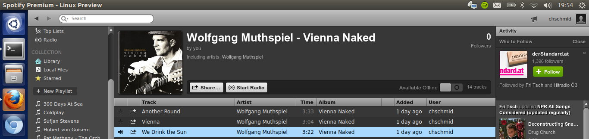

Ubuntu comes with almost everything that you can think of out of the box. And almost all of those little exceptions can be found elsewhere. So here's how to install a couple of those things that I just would not want to miss ;)

## Spotify

```
sudo add-apt-repository "deb http://repository.spotify.com stable non-free"
sudo apt-key adv --keyserver keyserver.ubuntu.com --recv-keys 94558F59
sudo apt-get update
sudo apt-get install spotify-client
```


## jdotxt

I have written an app to keep track of my todos, lets install it!

```
sudo add-apt-repository ppa:chms/jdotxt
sudo apt-get update
sudo apt-get install jdotxt
```

## owncloud client

Can be installed as described at [http://software.opensuse.org/download/package?project=isv:ownCloud:devel&package=owncloud-client](http://software.opensuse.org/download/package?project=isv:ownCloud:devel&package=owncloud-client)

```
sudo echo 'deb http://download.opensuse.org/repositories/isv:ownCloud:devel/xUbuntu_13.10/ /' >> /etc/apt/sources.list.d/owncloud-client.list
sudo apt-get update
sudo apt-get install owncloud-client
```
