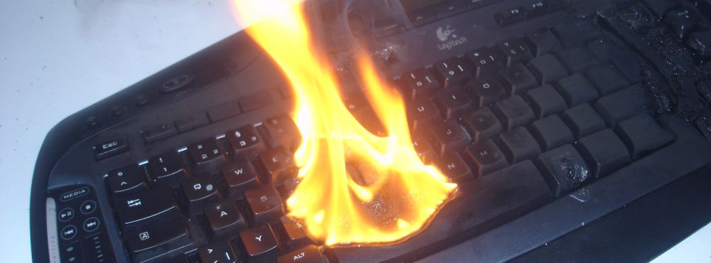

Apart from some minor owncloud glitches [me.chschmid.com](http://me.chschmid.com) is running pretty smoothly right now. It's doing a great job, both as [my server](/blog/the-making-of-me-chschmid-com-part-5-server-configuration/ "The Making of me.chschmid.com, Part 5: Server Configuration") and [my Desktop replacement](/blog/the-making-of-me-chschmid-com-part-7-some-more-client-software/ "The Making of me.chschmid.com, Part 7: Some More Client Software"). But I can't guarantee that it will stay that way. Neither can I expect the hard disk drives (HDD) to last forever nor can I guarantee that some idiots won't burn down the apartment building by setting their Christmas tree on fire. (Don't laugh, it has happened to my sister)

 Used under [CC BY-SA 3.0](http://creativecommons.org/licenses/by-sa/3.0/deed.en), originally by [Diether](http://commons.wikimedia.org/wiki/User:Diether)

So a backup strategy is in inevitable. Now for the first scenario (a dying HDD) people have come up with a solution known as RAID. However that is not what I am doing. For simplicity, I just copy most of my important stuff from one HDD to another once a day. - Actually the server does this automatically via a [cron job](http://en.wikipedia.org/wiki/Cron) file /etc/cron.d/cSBackupLocal

```
12 4    * * *    root    /usr/local/bin/cSBackupLocal.sh;
```

which executes a simple rsync script /usr/local/bin/cSBackupLocal.sh that does

```
# Backup data from first hard drive (me1) to second hard drive (me2)

# GIT - My life and stuff
rsync -a --delete /media/me1/git/   /media/me2/Backup/git

# Music - My other life support
rsync -a --delete /media/me1/Music/ /media/me2/Backup/Music

# owncloud
rsync -a --delete /media/me1/ocdata/ /media/me2/Backup/ocdata
```

The second scenario (house burning down) can not be dealt with that easily. E.g., with the two HDDs that do the mirroring once a day at the same location, a fire would destroy both. So you have to have a copy at some other place.

My most important things (about 20 megs) I have in an encrypted archive that is synced to Dropbox. Things like my [Keepass file](/blog/use-keepass-or-get-screwed/ "Use Keepass or Get Screwed") and Scans of important documents. - You are right, they might give that file to the NSA or something, but as it is encrypted they'll chew on it for a while.

The only viable solution for my more extended remote backup is to have an external hard drive, that I bring for doing a backup every now and then. When it is not plugged into my server for backup it is stored away safely somewhere else. - As in not within a 5 km range of my apartment. Obviously this system has flaws, like if there is a fire the day I do the external backup, I am still screwed. - But I guess that is as safe as it gets.
