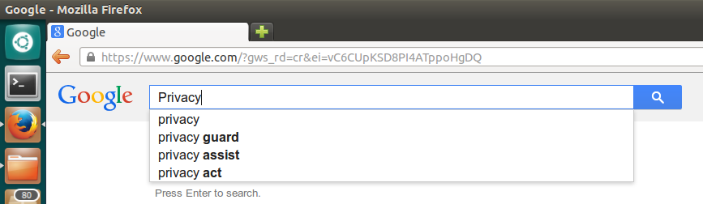

Privacy is a hot topic these days and part of virtually every coffee break discussion I know of. How much do they know? The Googles, Facebooks, Dropboxes, Wunderlists and above all the NSA.  
Actually a lot of people who have no idea about the technology side of things have started asking me these questions lately. I can see that their not knowing about the hidden magic in the background that enables the services they use on a daily basis makes them feel really uneasy. The truth is, its simple.

## Communication

First of all there is communication between computers, which, on a technical level, is the only thing the web itself allows us to do. When you ask google for search results, when you push your files to dropbox, when you have that Skype call with your mom - it's all communication and exchange of information between two computers over the web.

Let's take that Skype call for instance and lets picture the web as a city with you in your house (as a stand in for your computer) and the streets that connect all the houses as data highways. Lets also say there is one guy in every street who controls the street. What happens when you want to send a message to your mom is you tell the guy in your street (your provider) to dispatch the message - it's wrapped in a nice envelope with your address and the destination on it so that he knows where it has to go. He will then walk to the next street, pass on your massage to the person controlling that street and this guy will do the same until the message arrives at your mom's place.

There are two problems associated with this in terms of privacy

1.  Everyone who is part of the delivery chain might have opened the envelope and might have looked at message.
2.  Even if they have not read your message, they know that there was communication going on between you and your mom and they will also know how much data was exchanged.

Problem 1 can be solved by encrypting the message so that it does not make sense to anyone who might read it on its way. - There are still some issues here when it comes to technical implementations, but essentially, if you do it right, you can make your messages close to unreadable to the outsider. - This by the way is common practice in a lot of applications, which is good. E.g. always look for websites that come via "https" instead of "http". The "s" really makes the difference! Problem 2 is a little bit harder but still solvable. Say you transmit a secret message to your mom asking her to pass another message to someone else. If anyone wants to track your message to the final destination it will become really difficult as not knowing about the message to your mom asking her to dispatch something for you will make it unclear if any outgoing message from your moms was from you or from her or from anyone else. The more people you put between you and your final destination the harder it will be to track your messages. Essentially this is the idea that the [Tor network](http://en.wikipedia.org/wiki/Tor_%28anonymity_network%29) is based on, however it is not widely used and not common practice.

## Data

The second aspect apart from communication is data. You do not only exchange information when storing your files on Dropbox, but you ask them to hold on to that data for you as you ask Google to store your e-mails and Wunderlist to store your todos. They might even store data that you do not ask them to store, like your seach history. The problem here is that those companies sometimes leak data (e.g., [PlayStation Network outage](http://en.wikipedia.org/wiki/PlayStation_Network_outage)) and sometimes share your data with other organizations such as the NSA.

To use the analogy with the city and the streets: If there is someone at your mom's place or at Dropbox's place who watches over their shoulder while they decrypt your message, your data will be available to them, even when the data transmission through the streets of your city was safe due to encryption.

If all you want to do is storing your data at someone else's place you can give it to them in an encrypted way. E.g. only store encrypted zip files on dropbox. Or you can opt out and don't give any data to them in the first place.

Obviously this does not work for your search terms, that Google has to know about in order to give you results.

## The Solution

There is not one size fits it all solution, but on central aspect is to be aware of what data you share online and how others may be able to use it. The analogy with the city and the streets will give you a pretty good idea of who can access what. I don't think sharing stuff is bad per se, you just have to know about the implications. To give you some examples.

-   Stuff that you put on a website, e.g., your blog, can be seen by absolutely everyone.
-   Stuff that you post to social networks may not be seen by anyone who happens to stand between you and the computers of that social network, but by whoever you allow it to see, by the social network itself and by anyone who they share this information with - willingly or by accident.
-   Even when you are just looking at stuff online you let others know about what you are looking at. This means amazon will learn about what you like simply from you browsing their website. - But to be honest: the employees at your local grocery store also know what you buy on a daily basis.

To be better off in terms of communication

-   Look for encryption so that at least your communication is secure. E.g., look for https instead of http, configurate your e-mail client so that it uses encrypted instead of unencrypted mail transfer.
-   Don't use things such as FTP to transfer files.
-   ...
-   and  finally:

## Use Your Own Cloud Storage

About 1.5 years ago I set up my own [Ubuntu](http://en.wikipedia.org/wiki/Ubuntu_%28operating_system%29) [GNU/Linux](http://en.wikipedia.org/wiki/Linux) server, that hosts all my [git repositories](http://en.wikipedia.org/wiki/Git_%28software%29), files (webdav), calendars (caldav) and contact data (carddav) via [owncloud](http://owncloud.org/) and many other services that I use. The Server is currently running on an AMD E-350 APU, which is soon to be replaced by something better. And that's the reason why this is just part 1. I'll post information about my new server setup in the next couple of days, so stay tuned!
