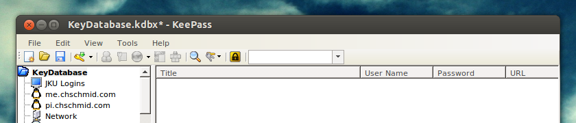

Today I received an e-mail from a website admin, informing me that two of their admins had misconducted. They had stolen the database + all user e-mails and passwords and of course used that information to log into other web services.

Using [keepass](http://keepass.info/) and different passwords for every website totally makes sense!!! What do you do to protect yourself against something like this?

