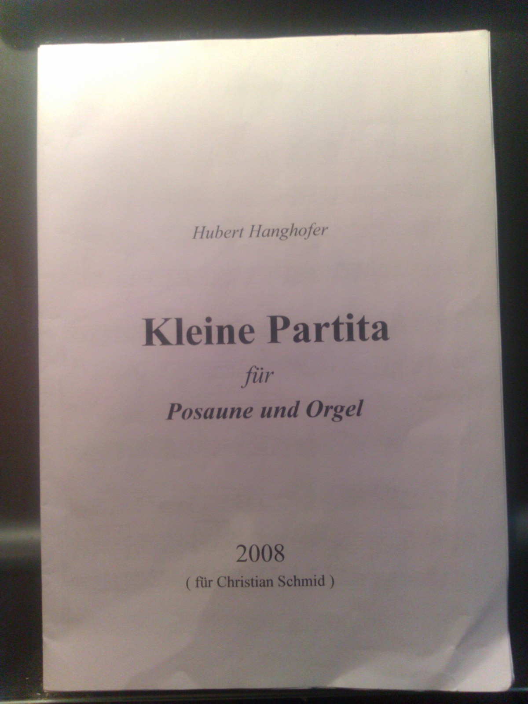

Looks like the world has not come to an end on December 21st 2012. With all of the end-of-the-world attitude gone we can not totally focus on 2013! So welcome to all of you who've survived New Year's Eve.

I guess my party was much like yours, eating, drinking, celebrating with friends, watching fireworks. What was a little special for me this year was that the organist of our church invited me to play some trombone / organ tunes that he had composed for me back in 2008. Here's one of the songs

[Listen on SoundCloud: Choral by chschmid](https://soundcloud.com/chschmid)

It's part of a collection of tunes which he calls "Kleine Partita" - Little Suite. While most of the songs are quite sad, I hope that your new year 2013 will be a happy one! I wish you, your family and friends all the best and I hope we'll meet again to share some happy hours together!
